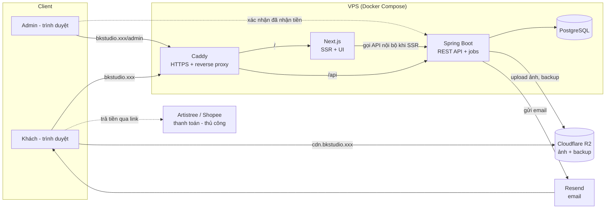

# Architecture — BKStudio

> Trạng thái: **Accepted** · Cập nhật: 2026-10-18
> Chi tiết và lý do từng lựa chọn: xem `docs/DECISIONS/`.

## 1. Stack tóm tắt
| Lớp | Lựa chọn | ADR |
|---|---|---|
| Frontend | Next.js (App Router, TypeScript) + Tailwind CSS | 0002 |
| Backend | Spring Boot, Java 25 (LTS), Maven — modular monolith | 0003, 0011 |
| Database | PostgreSQL + Flyway | 0004 |
| Hosting | 1 VPS ≥ 4 GB ở **Singapore** + Docker Compose + Caddy (HTTPS) | 0005 |
| DNS / domain | Cloudflare | 0005 |
| Xác thực | Admin: session cookie + TOTP 2FA. Khách: token trong link đơn | 0006 |
| Ảnh | Cloudflare R2 + CDN | 0007 |
| Thanh toán | `PaymentRequest` thủ công (Artistree / Shopee + mua hộ) | 0008 |
| Email | Resend (dự phòng: Brevo), qua outbox | 0009 |
| Vận hành | Log JSON, uptime monitor, pg_dump → R2, CI bằng GitHub Actions | 0010 |

## 2. Sơ đồ hệ thống


## 3. Module backend
| Module | Trách nhiệm |
|---|---|
| `catalog` | Sản phẩm, biến thể tỉ lệ, ảnh, tồn kho hàng có sẵn |
| `order` | Giỏ → đơn, máy trạng thái đơn, giữ hàng 48h, audit log |
| `queue` | Sức chứa slot theo tháng, xếp hàng đợi, tính thời gian chờ dự kiến |
| `payment` | `PaymentRequest`, xác nhận thủ công, `PaymentChannel` interface |
| `notification` | Email outbox, template, gửi lại khi lỗi |
| `admin` | Đăng nhập + TOTP, endpoint quản trị |
| `shared` | Lỗi chung, validate, cấu hình, tiện ích thời gian/tiền |

## 4. Cấu trúc repo (dự kiến)
```
BKStudio/
├── backend/        # Spring Boot (Maven)
├── frontend/       # Next.js
├── infra/          # docker-compose.yml, Caddyfile, script backup
├── docs/           # tài liệu dự án + ADR
└── .github/workflows/
```

## 5. Chi phí ước tính hằng tháng
| Khoản | Ước tính | Ghi chú |
|---|---|---|
| VPS 4 GB ở Singapore + IPv4 + backup | **chưa chắc chắn, mục tiêu ≤ $15** | Giá Hetzner 2026 không thống nhất giữa các nguồn; xem console khi deploy (ADR-0005) |
| Cloudflare R2 | $0 | Free tier 10 GB, egress miễn phí |
| Resend | $0 | Free tier 3.000 email/tháng |
| Cloudflare DNS | $0 | |
| Tên miền | ~$10–15/năm (~$1/tháng) | Tuỳ đuôi tên miền |
| **Tổng** | **mục tiêu ≤ $16/tháng** | Vượt thì chủ dự án duyệt trước |

## 6. Còn chờ quyết định
- Nhà cung cấp VPS cụ thể (theo giá thật lúc deploy — quy tắc trong ADR-0005).
- Tên miền.
- Xác nhận ToS Artistree về hàng vật lý (ADR-0008).
