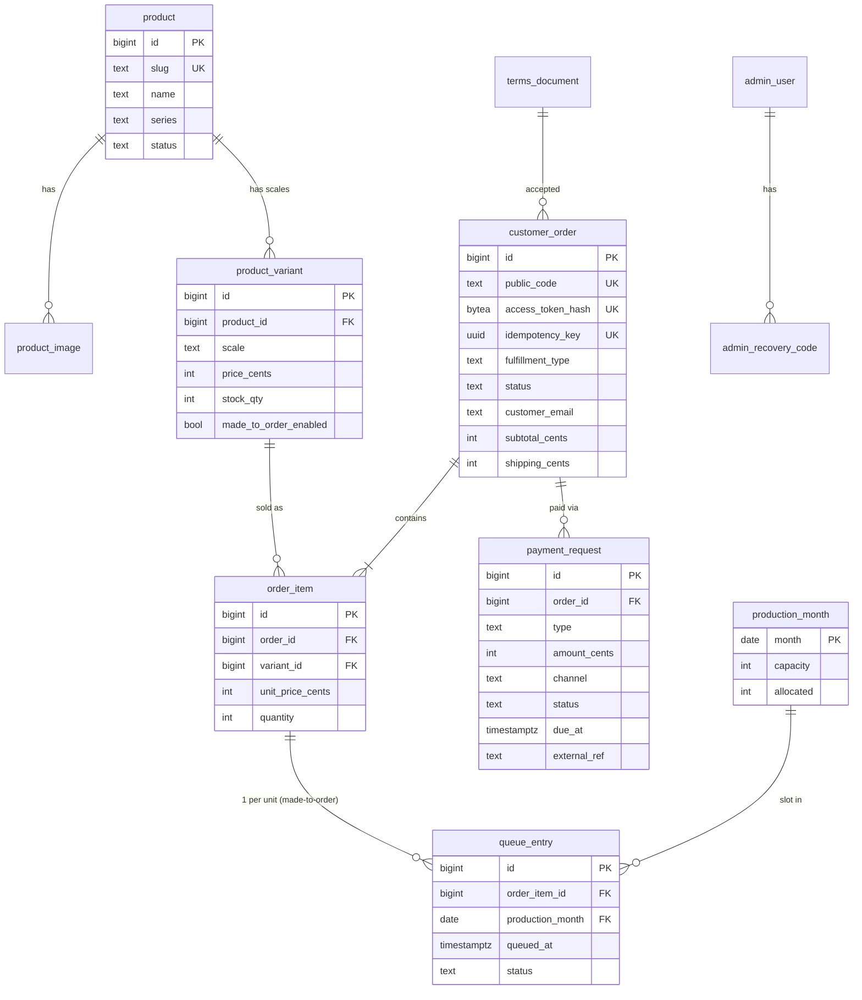

# Database — BKStudio

> Trạng thái: **Đã duyệt (Phase 3)** · Cập nhật: 2026-10-18
> DDL đầy đủ: [`schema-draft.sql`](schema-draft.sql) — đã chạy thử trên **PostgreSQL 16.15** (xem mục 5).
> **Nguồn sự thật hiện tại: `backend/src/main/resources/db/migration/V1__init.sql`** (T-003). `schema-draft.sql` chỉ là bản thiết kế; V1 khác ở: tên constraint/index tường minh, thêm `chk_order_access_token_hash_length`, `chk_admin_user_totp_secret_when_enabled`, và `uq_admin_user_email_lower` (unique trên `lower(email)`). 17 tình huống ở mục 5 đã thành test tự động (`DbConstraintsIT`).

## 1. Quy ước
| Quy ước | Lý do |
|---|---|
| Tiền lưu bằng **số nguyên cent USD** (`int`), không dùng `float`/`double` | `0.1 + 0.2 ≠ 0.3` với số thực — sai tiền là lỗi nghiêm trọng |
| Thời gian là **`timestamptz` (UTC)**, hiển thị theo múi giờ người xem | Admin ở UTC+7, khách ở SG/AU; hạn chót phải tính thống nhất |
| Khoá chính `bigint GENERATED ALWAYS AS IDENTITY` | Chuẩn PostgreSQL hiện đại (thay `SERIAL`) |
| Bảng hay sửa có cột `version` | Optimistic locking (`@Version` trong JPA) — 2 tab admin sửa cùng lúc thì tab sau bị báo xung đột thay vì ghi đè im lặng |
| Đơn hàng lưu **bản chụp** (tên, tỉ lệ, giá) | Sửa sản phẩm sau này không làm sai đơn cũ |
| Ràng buộc quan trọng đặt **ở DB** (CHECK, UNIQUE, partial index), không chỉ ở code | Lưới an toàn cuối cùng nếu code có bug |
| Đặt tên constraint tường minh trong migration thật (vd `chk_order_shipped_needs_tracking`) | Để backend dịch lỗi DB thành thông báo dễ hiểu |

## 2. ERD

Bảng phụ không vẽ: `app_setting`, `email_outbox`, `audit_log`, `admin_user`.

## 3. Các bảng chính
| Bảng | Vai trò | Điểm thiết kế đáng chú ý |
|---|---|---|
| `product` | Sản phẩm (nhân vật) | `slug` cho URL đẹp: `/products/pneuma`. Trạng thái `UNLISTED` = sản phẩm commission ẩn, chỉ vào bằng link (slug có hậu tố ngẫu nhiên, vd `alex-custom-ganyu-7k2m9x`) |
| `product_variant` | Mỗi tỉ lệ 1 dòng | **Một biến thể có thể vừa có hàng sẵn (`stock_qty`) vừa nhận làm theo đơn** → figure bị bỏ cọc chỉ cần `stock_qty + số lượng từng dòng hàng` để bán lại. `CHECK (stock_qty >= 0)`. `made_to_order_quota` (NULL = không giới hạn, 1 = commission 1 suất) |
| `production_month` | Sức chứa slot mỗi tháng | `CHECK (allocated <= capacity)` → **DB không cho phép overbook** |
| `customer_order` | Đơn hàng | Không lưu token truy cập, chỉ lưu **hash SHA-256** (lộ DB cũng không dùng được link). `idempotency_key` chống tạo trùng đơn. Lưu `terms_version` + thời điểm + IP đồng ý điều khoản (bằng chứng khi tranh chấp). `restocked_at` (V2): thời điểm đơn `FORFEITED` được đưa figure về kho |
| `order_item` | Dòng sản phẩm trong đơn | Bản chụp tên/tỉ lệ/giá |
| `queue_entry` | 1 dòng = 1 slot | Thứ tự trong tháng theo `queued_at` (lúc cọc được xác nhận) |
| `payment_request` | Mỗi lần thu tiền | Partial unique index: tối đa 1 yêu cầu `PENDING` và 1 `PAID` mỗi loại mỗi đơn; **1 mã invoice ngoài chỉ dùng được 1 lần** |
| `email_outbox` | Hàng đợi email | `dedupe_key` UNIQUE → job chạy lại cũng không gửi email nhắc 2 lần |
| `audit_log` | Ai làm gì, lúc nào | Lưu giá trị trước/sau dạng `jsonb` |
| `terms_document` | Các phiên bản điều khoản | Biết chính xác khách đã đồng ý nội dung nào |

## 4. Các ràng buộc nghiệp vụ ở tầng DB
| Luật | Cách DB đảm bảo |
|---|---|
| Commission 1 suất chỉ 1 khách đặt được | Cùng cách trừ kho: `UPDATE … SET made_to_order_quota = made_to_order_quota - 1 WHERE … >= 1` + `CHECK (>= 0)` |
| Không bán quá số hàng sẵn | `UPDATE … SET stock_qty = stock_qty - n WHERE id = ? AND stock_qty >= n` (0 dòng = hết hàng) + `CHECK (stock_qty >= 0)` |
| Không overbook slot | `CHECK (allocated <= capacity)` + cấp slot bằng `FOR UPDATE SKIP LOCKED` |
| Bấm "Đặt hàng" 2 lần không tạo 2 đơn | `idempotency_key` UNIQUE |
| Đơn làm theo đơn không thể ở trạng thái của hàng sẵn và ngược lại | CHECK theo `fulfillment_type` |
| Không thể "Đã gửi hàng" khi chưa có mã vận đơn | CHECK |
| Không thể xác nhận đã trả tiền khi chưa ghi mã tham chiếu | CHECK `status='PAID' ⇔ external_ref & confirmed_at có giá trị` |
| Không thể dùng 1 invoice Artistree cho 2 khoản | Partial unique `(channel, external_ref)` |
| Link thanh toán phải là `https://` | CHECK (chặn `javascript:` …) |
| Figure bị bỏ cọc chỉ được cộng lại vào kho 1 lần | `UPDATE customer_order SET restocked_at = ? WHERE id = ? AND restocked_at IS NULL AND status = 'FORFEITED'` (0 dòng = đã về kho, không cộng `stock_qty` lần nữa) + `chk_order_restocked_only_forfeited`: `restocked_at` chỉ có giá trị khi `status = 'FORFEITED'` |

## 5. Kết quả chạy thử (PostgreSQL 16.15)
Các tình huống dưới đây đã chạy thật trên DB (test 15–17 thêm khi bổ sung commission); chúng sẽ được viết lại thành integration test (Testcontainers) ở Phase 4.

| # | Tình huống | Kết quả |
|---|---|---|
| 1 | 2 khách cùng mua **món cuối cùng** cùng lúc (2 kết nối song song) | ✅ Chỉ 1 người mua được, tồn kho = 0 |
| 2 | Query lỗi cố trừ kho xuống âm | ✅ Bị CHECK chặn |
| 3 | 2 cọc được xác nhận cùng lúc, tháng 11 còn 1 slot, tháng 12 còn 2 | ✅ Đơn A → tháng 11, đơn B → tháng 12 (không chờ, không trùng) |
| 4 | Cố đặt `allocated > capacity` | ✅ Bị CHECK chặn |
| 5 | Checkout gửi lại với cùng idempotency key | ✅ Không tạo đơn thứ 2 |
| 6 | Đơn làm theo đơn bị đặt trạng thái `AWAITING_PAYMENT` | ✅ Bị chặn |
| 7 | `SHIPPED` khi chưa có mã vận đơn | ✅ Bị chặn |
| 8 | Tạo 2 yêu cầu cọc đang chờ cho cùng 1 đơn | ✅ Bị chặn |
| 9 | Admin bấm "Xác nhận đã nhận tiền" 2 lần | ✅ Lần 2 không làm gì (0 dòng) |
| 10 | Dùng lại mã invoice của đơn khác | ✅ Bị chặn |
| 11 | Đánh dấu đã trả mà không có mã tham chiếu | ✅ Bị chặn |
| 12 | Link thanh toán `javascript:…` | ✅ Bị chặn |
| 13 | Đơn hàng sẵn bị đặt trạng thái `QUEUED` | ✅ Bị chặn |
| 14 | Luồng hợp lệ: trả đủ → gửi hàng có mã vận đơn | ✅ Chạy bình thường |
| 15 | Danh sách catalog có sản phẩm `UNLISTED` | ✅ Không hiện |
| 16 | 2 người cùng đặt commission 1 suất cùng lúc | ✅ Chỉ 1 người đặt được, quota = 0 |
| 17 | Quota bị trừ xuống âm | ✅ Bị CHECK chặn |

Ghi chú học được khi test: `ON CONFLICT DO NOTHING` vẫn "tiêu" 1 số id → id có thể nhảy cóc. Vì vậy mã đơn cho khách (`public_code`) là cột riêng, không dùng id.

## 6. Lưu giữ dữ liệu (privacy)
- Chỉ thu: tên, email, địa chỉ giao hàng, SĐT (tuỳ chọn) — đủ để giao hàng.
- ✅ Sau **2 năm** kể từ khi đơn kết thúc, xoá/ẩn danh thông tin liên hệ & địa chỉ (giữ số tiền, sản phẩm cho thống kê) — job hằng tháng.
