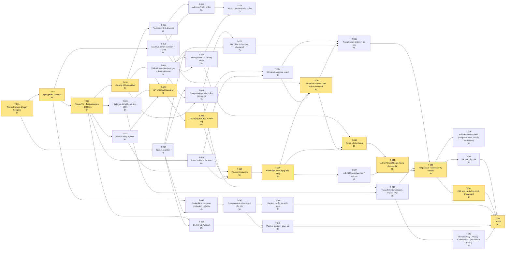

# Tasks — BKStudio

> **File này được sinh tự động** từ `docs/tasks.py` (`python3 docs/tasks.py --render`). Sửa dữ liệu trong `tasks.py`, không sửa tay file này.
> Trạng thái task theo dõi bằng cột *Status*: `todo` → `doing` → `done` (cập nhật trong `tasks.py`).

## Tổng quan

| Nhóm | Giờ | Task |
|---|---|---|
| M0 — Setup | 20 | T-001, T-002, T-003, T-004, T-005, T-007 |
| M1 — Catalog & đăng nhập admin | 52 | T-006, T-010, T-011, T-012, T-013, T-014, T-015, T-016, T-017 |
| M2 — Đơn hàng, thanh toán, hàng đợi | 50 | T-020, T-021, T-022, T-023, T-024, T-025, T-026, T-027, T-028, T-029 |
| M3 — Giao diện khách & admin | 39 | T-030, T-031, T-032, T-033, T-034, T-035, T-036 |
| M4 — Bảo mật, deploy, launch | 39 | T-040, T-041, T-042, T-043, T-044, T-045, T-046, T-047, T-052 |
| M5 — Làm ngay sau launch | 3 | T-050, T-051 |
| P1 — Chỉ làm nếu còn thời gian | 19 | T-060, T-061, T-062, T-063, T-064, T-065 |
| **Cần để launch** | **189** | M0–M4 |

**Critical path** (chuỗi phụ thuộc dài nhất, 74 giờ): T-001 → T-002 → T-003 → T-010 → T-022 → T-023 → T-025 → T-026 → T-029 → T-033 → T-034 → T-035 → T-041 → T-046

## Sơ đồ phụ thuộc (task cần để launch)

Ô màu vàng = critical path. Vì chỉ có 1 người làm, các task **không** chạy song song thật sự; "song song được" nghĩa là **đổi thứ tự thoải mái** (vd đang kẹt backend thì chuyển sang task frontend không phụ thuộc).

## Chi tiết task

### M0 — Setup

#### T-001 · Repo structure & local Postgres
- **Ưu tiên:** P0 · **Ước lượng:** 3 giờ · **Phụ thuộc:** — · **Status:** done · **Thực tế:** 3 giờ
- **Phạm vi:** Thư mục `backend/ frontend/ infra/`; `.editorconfig`; `.env.example`; `infra/docker-compose.dev.yml` chạy PostgreSQL 16 + MinIO (giả lập R2).
- **File / module:** infra/docker-compose.dev.yml, .env.example
- **Nghiệm thu:** `docker compose -f infra/docker-compose.dev.yml up` chạy được Postgres + MinIO; README có hướng dẫn chạy local.
- **Test:** Kết nối psql thành công.
- **Rủi ro / câu hỏi:** Docker Desktop trên Windows cần WSL2.

#### T-002 · Spring Boot skeleton
- **Ưu tiên:** P0 · **Ước lượng:** 4 giờ · **Phụ thuộc:** T-001 · **Status:** done
- **Phạm vi:** Maven, Java 25 (ADR-0011), package theo module (catalog, order, queue, payment, notification, admin, shared); `/api/health`; `@RestControllerAdvice` → ProblemDetail có `code` + `requestId`; filter gắn `X-Request-Id`; log JSON.
- **File / module:** backend/pom.xml, backend/src/main/java/.../shared/*
- **Nghiệm thu:** `./mvnw verify` xanh; `GET /api/health` trả `{status:UP}`; lỗi trả đúng định dạng API_SPEC §1.
- **Test:** Unit test cho exception handler; MockMvc test health.
- **Rủi ro / câu hỏi:** Chọn đúng bản Spring Boot ổn định mới nhất.

#### T-003 · Flyway V1 + Testcontainers + DB tests
- **Ưu tiên:** P0 · **Ước lượng:** 5 giờ · **Phụ thuộc:** T-002 · **Status:** done
- **Phạm vi:** Chuyển `docs/schema-draft.sql` thành `V1__init.sql` (đặt tên constraint tường minh); base class integration test với Testcontainers; viết lại 17 tình huống trong DATABASE.md §5 thành test.
- **File / module:** backend/src/main/resources/db/migration/V1__init.sql, backend/src/test/.../DbConstraintsIT.java
- **Nghiệm thu:** 17 test DB xanh trên PostgreSQL thật trong container.
- **Test:** Integration test (Testcontainers).
- **Rủi ro / câu hỏi:** Testcontainers trên Windows cần Docker chạy.

#### T-004 · Next.js skeleton
- **Ưu tiên:** P0 · **Ước lượng:** 4 giờ · **Phụ thuộc:** T-001 · **Status:** done
- **Phạm vi:** Next.js App Router + TypeScript + Tailwind; layout chung; API client gọi `/api` (rewrite sang backend khi dev); error boundary hiển thị requestId; ESLint + Prettier.
- **File / module:** frontend/*
- **Nghiệm thu:** `npm run build` thành công; trang chủ gọi được `/api/health` qua proxy.
- **Test:** `npm run lint` + build.
- **Rủi ro / câu hỏi:** Học App Router (server vs client component).

#### T-005 · CI (GitHub Actions)
- **Ưu tiên:** P0 · **Ước lượng:** 3 giờ · **Phụ thuộc:** T-003, T-004 · **Status:** done
- **Phạm vi:** Workflow: backend `mvn verify` (có Testcontainers), frontend lint + build, gitleaks quét secret; Dependabot cho Maven + npm.
- **File / module:** .github/workflows/ci.yml, .github/dependabot.yml
- **Nghiệm thu:** PR mở ra thì CI chạy và xanh; commit thử 1 secret giả bị gitleaks bắt.
- **Test:** Chính CI.
- **Rủi ro / câu hỏi:** —

#### T-007 · Hardening build: Spotless + checksum Maven wrapper
- **Ưu tiên:** P1 (làm sau launch được) · **Ước lượng:** 1 giờ · **Phụ thuộc:** T-005 · **Status:** done
- **Phạm vi:** Thêm Spotless (palantir-java-format), `spotless:check` gắn vào phase `process-sources` nên `verify` (và CI) thực thi, `ci.yml` không đổi (DEVELOPMENT.md §4); thêm `distributionSha256Sum` vào `backend/.mvn/wrapper/maven-wrapper.properties` (từ review T-005).
- **File / module:** backend/pom.xml, backend/.mvn/wrapper/maven-wrapper.properties
- **Nghiệm thu:** CI đỏ khi code Java sai định dạng; `./mvnw` từ chối bản Maven sai checksum.
- **Test:** Chính CI.
- **Rủi ro / câu hỏi:** Spotless sẽ định dạng lại code đã có (diff lớn một lần).

### M1 — Catalog & đăng nhập admin

#### T-006 · Thiết kế giao diện (mockup + design tokens)
- **Ưu tiên:** P0 · **Ước lượng:** 5 giờ · **Phụ thuộc:** — · **Status:** done
- **Phạm vi:** Định hướng thương hiệu từ logo capybara; mockup trang chủ (desktop + mobile), sản phẩm, Commission, giỏ hàng, checkout, trạng thái đơn trên canvas thiết kế; chọn font Rubik; ghi design tokens (màu, font, viền, bóng, bo góc) vào `docs/DESIGN.md` + `docs/design/tokens.css`.
- **File / module:** docs/DESIGN.md, docs/design/*
- **Nghiệm thu:** Chủ dự án duyệt hướng thiết kế và font; tokens có trong repo.
- **Test:** Duyệt bằng mắt trên canvas.
- **Rủi ro / câu hỏi:** Tên hiển thị đã chốt: BKStudio. Ảnh sản phẩm cần chụp lại trước launch.

#### T-010 · Catalog API công khai
- **Ưu tiên:** P0 · **Ước lượng:** 5 giờ · **Phụ thuộc:** T-003 · **Status:** done
- **Phạm vi:** Entity + repository product/variant/image; `GET /api/products` (chỉ ACTIVE), `GET /api/products/{slug}` (ACTIVE + UNLISTED, cờ `unlisted`); tình trạng có sẵn / làm theo đơn (tôn trọng quota); không lộ số tồn kho.
- **File / module:** backend/.../catalog/*
- **Nghiệm thu:** Đúng hợp đồng API_SPEC §2; UNLISTED không bao giờ xuất hiện trong danh sách.
- **Test:** Integration test cho list/detail/UNLISTED/quota hết.
- **Rủi ro / câu hỏi:** `estimatedStartMonth` = null tới T-021; `R2_PUBLIC_BASE_URL` phải đặt ở prod (T-043), mặc định là MinIO local; thiếu Cache-Control/rate limit cho GET công khai (Caddy/Cloudflare); CatalogService (domain) import DTO của api — tách trước T-021/T-022.

#### T-011 · Pipeline xử lý & lưu ảnh
- **Ưu tiên:** P0 · **Ước lượng:** 6 giờ · **Phụ thuộc:** T-010 · **Status:** done
- **Phạm vi:** Kiểm tra magic bytes, ≤10 MB, ≤8000×8000 và ≤40 MP; decode → WebP 400/1000/2000 (mất EXIF, xoay theo orientation); upload R2 (S3 SDK; MinIO khi dev); key ngẫu nhiên; xoá ảnh. Chỉ là service, endpoint upload ở T-013.
- **File / module:** backend/.../catalog/image/*
- **Nghiệm thu:** Ảnh JPEG/PNG hợp lệ → 3 file WebP trên storage (đầu vào WebP bị từ chối — rủi ro libwebp native, ADR-0007); file `.php` đổi đuôi `.jpg` bị từ chối; ảnh có GPS EXIF → output không còn EXIF.
- **Test:** Unit test với file mẫu (hợp lệ, giả mạo, quá lớn); integration test với MinIO.
- **Rủi ro / câu hỏi:** Thư viện `gotson/webp-imageio` 0.2.2 không còn bảo trì, native glibc x86_64/aarch64 → image Docker phải Ubuntu, không Alpine (T-042). Cần: cờ `--enable-native-access=ALL-UNNAMED` trong Dockerfile; thử `java -jar` upload thật (SPI ImageIO trong fat jar chưa kiểm); giới hạn upload đồng thời + `multipart.max-file-size` + heap/container memory (T-013, T-042); R2 token chỉ Object Read/Write; ảnh chưa step-down khi thu nhỏ rất nhiều (hơi răng cưa).

#### T-012 · Xác thực admin (session + TOTP)
- **Ưu tiên:** P0 · **Ước lượng:** 8 giờ · **Phụ thuộc:** T-002 · **Status:** done
- **Phạm vi:** Spring Security: login 2 bước (mật khẩu Argon2id → TOTP), đổi session ID, CSRF cookie→header, timeout 30 phút/12 giờ, khoá tạm 5 lần sai/15 phút (theo IP: mọi lần sai; theo tài khoản: chỉ lần sai TOTP/mã khôi phục, để kẻ biết email không khoá được admin), 10 mã khôi phục, secret TOTP mã hoá AES-GCM; lệnh CLI `--create-admin` tạo admin đầu tiên. Đã bỏ chế độ học (Khai, 2026-10-26): subagent viết code.
- **File / module:** backend/.../admin/auth/*
- **Nghiệm thu:** Không có TOTP thì không vào được `/api/admin/**`; sai 5 lần (TOTP/mã khôi phục) bị khoá, IP sai 5 lần bị chặn; request thiếu CSRF bị 403; mã khôi phục dùng 1 lần.
- **Test:** Integration test cho từng tiêu chí trên.
- **Rủi ro / câu hỏi:** Nợ chấp nhận, xử lý ở T-043: session/bộ chặn IP/guard TOTP trong bộ nhớ (mất khi restart); IP = getRemoteAddr nên sau Caddy phải cấu hình `server.forward-headers-strategy` (cũng ảnh hưởng cờ Secure của cookie XSRF-TOKEN) — BẮT BUỘC trước khi mở production, nếu không 5 request rác từ ai cũng chặn cả admin 15 phút; email thông báo đăng nhập tới bk3dprinls@gmail.com chờ hạ tầng email; `--create-admin` chưa chạy thật end-to-end (Khai chạy khi tạo admin); mọi POST công khai (checkout T-022) cần CSRF token; route admin mới phải nằm dưới /api/admin/** (mặc định ngoài đó là permitAll); AES-GCM chưa có AAD gắn admin id.

#### T-013 · Admin API sản phẩm
- **Ưu tiên:** P0 · **Ước lượng:** 5 giờ · **Phụ thuộc:** T-011, T-012 · **Status:** done
- **Phạm vi:** CRUD product/variant (giá, tồn kho, bật làm theo đơn, quota, `version`); UNLISTED tự gắn hậu tố slug ngẫu nhiên; upload/sắp xếp/sửa alt/xoá ảnh.
- **File / module:** backend/.../catalog/admin/*
- **Nghiệm thu:** Đúng API_SPEC §3 Sản phẩm; sửa với `version` cũ → 409 VERSION_CONFLICT.
- **Test:** Integration test.
- **Rủi ro / câu hỏi:** Đã thêm `GET /api/admin/products/{id}`, mã lỗi CONFLICT/PAYLOAD_TOO_LARGE, AuditLogWriter dùng chung, `JacksonConfig` (từ chối số cho enum). Nợ: file ảnh mồ côi nếu lỗi giữa chừng (chưa có job dọn); xoá/ghi lại slug UNLISTED khi đổi trạng thái làm link cũ chết (không redirect); hai lần cùng sinh trùng hậu tố 52 bit có thể 500 (xác suất ~2^-52); giới hạn tốc độ GET công khai trước production vì slug UNLISTED là bí mật duy nhất; `stock_qty` là ghi đè tuyệt đối — code trừ kho ở T-022 PHẢI tăng `version` cùng lúc; reorder không đổi vẫn ghi audit; Caddy phải cho body ≥ 11 MB trên /api/admin.

#### T-014 · Trang catalog & sản phẩm (frontend)
- **Ưu tiên:** P0 · **Ước lượng:** 7 giờ · **Phụ thuộc:** T-004, T-006, T-010 · **Status:** done
- **Phạm vi:** Áp dụng design tokens (`docs/DESIGN.md` §5: Rubik qua `next/font`, khối `@theme` của Tailwind, bỏ dark mode mặc định, header/footer theo mockup). Trang danh sách (lọc series), trang chi tiết (gallery `srcset`, chọn tỉ lệ, có sẵn / làm theo đơn + tháng dự kiến); render trên server; thẻ Open Graph; `noindex` cho UNLISTED; sitemap chỉ ACTIVE.
- **File / module:** frontend/src/app/(shop)/*, frontend/src/components/shop/*, frontend/src/app/{sitemap,robots}.ts
- **Nghiệm thu:** Dán link sản phẩm vào trình kiểm tra OG (vd Facebook Sharing Debugger hoặc opengraph.xyz) thấy ảnh + tên + giá.
- **Test:** Kiểm tra thủ công + build.
- **Rủi ro / câu hỏi:** —

#### T-015 · Khung admin UI + đăng nhập
- **Ưu tiên:** P0 · **Ước lượng:** 5 giờ · **Phụ thuộc:** T-004, T-006, T-012 · **Status:** done
- **Phạm vi:** Trang login + nhập TOTP + mã khôi phục; layout admin; chặn route khi chưa đăng nhập; xử lý CSRF trong API client.
- **File / module:** frontend/src/app/admin/*, frontend/src/lib/api.ts
- **Nghiệm thu:** Đăng nhập đủ 2 bước vào được admin; hết session tự về trang login.
- **Test:** Kiểm tra thủ công; E2E ở T-041.
- **Rủi ro / câu hỏi:** —

#### T-016 · Admin UI quản lý sản phẩm
- **Ưu tiên:** P0 · **Ước lượng:** 7 giờ · **Phụ thuộc:** T-013, T-015 · **Status:** done
- **Phạm vi:** Danh sách + form sản phẩm, biến thể, upload ảnh kéo-thả + sắp xếp, chọn trạng thái (DRAFT/ACTIVE/UNLISTED/ARCHIVED), nút "Sao chép link" cho commission.
- **File / module:** frontend/src/app/admin/(console)/products/*
- **Nghiệm thu:** Tạo được sản phẩm thật từ đầu đến khi hiện trên catalog; tạo được sản phẩm commission và copy link.
- **Test:** Kiểm tra thủ công.
- **Rủi ro / câu hỏi:** UI upload ảnh tốn thời gian hơn dự kiến.

#### T-017 · Chế độ tối (shop + admin)
- **Ưu tiên:** P1 (làm sau launch được) · **Ước lượng:** 4 giờ · **Phụ thuộc:** T-014, T-016 · **Status:** done
- **Phạm vi:** Bảng màu tối trong `docs/DESIGN.md` + `docs/design/tokens.css` (Khai chốt 2026-10-28: nền #1A1714, thẻ #2A2520, chữ #F4F1EA, viền/bóng cream/citrus); đo tương phản WCAG AA; khối `[data-theme=dark]` + `prefers-color-scheme` trong `globals.css`; nút bật/tắt tay (lưu localStorage, không nháy sai theme lúc tải trang); chuyển hex cứng của admin sang token.
- **File / module:** docs/DESIGN.md, docs/design/tokens.css, frontend/src/app/globals.css, frontend/src/components/*, frontend/src/app/admin/*
- **Nghiệm thu:** Mặc định theo hệ điều hành, nút đổi tay nhớ lựa chọn sau F5 và không nháy; mọi trang shop + admin đọc được ở cả 2 chế độ; chữ thường đạt ≥ 4.5:1.
- **Test:** Kiểm tra thủ công cả 2 chế độ ở 375px/1280px; script tính tương phản.
- **Rủi ro / câu hỏi:** Chữ đỏ (`red` #D63A1A) chỉ 3.8:1 trên nền tối → cần token chữ nhấn sáng hơn; bóng đổ citrus có thể quá chói.

### M2 — Đơn hàng, thanh toán, hàng đợi

#### T-020 · Settings, điều khoản, link MXH
- **Ưu tiên:** P0 · **Ước lượng:** 3 giờ · **Phụ thuộc:** T-003 · **Status:** done
- **Phạm vi:** `app_setting` (sức chứa mặc định, tên miền link cho phép, link MXH…), `terms_document`; `GET /api/terms/current`, `GET /api/site-info`; admin GET/PUT settings, đăng điều khoản mới.
- **File / module:** backend/.../shared/settings/*
- **Nghiệm thu:** Đúng API_SPEC.
- **Test:** Integration test.
- **Rủi ro / câu hỏi:** —

#### T-021 · Module hàng đợi slot
- **Ưu tiên:** P0 · **Ước lượng:** 4 giờ · **Phụ thuộc:** T-003 · **Status:** done
- **Phạm vi:** Tự tạo `production_month`; ước tính tháng; cấp slot (`FOR UPDATE SKIP LOCKED`) và trả slot; admin xem/sửa sức chứa (≥ allocated).
- **File / module:** backend/.../queue/*
- **Nghiệm thu:** 2 lần cấp slot song song không bao giờ vượt capacity; giảm capacity dưới allocated bị từ chối.
- **Test:** Integration test có chạy song song (2 thread).
- **Rủi ro / câu hỏi:** Từ T-021: `QueueService.allocate` chỉ gọi 1 lần cho mỗi item (xác nhận cọc phải idempotent); `orderItemId` do server tạo; `QUEUE_FULL` có thể do deadlock nhiều chiếc nên cân nhắc retry.

#### T-022 · API checkout (tạo đơn)
- **Ưu tiên:** P0 · **Ước lượng:** 7 giờ · **Phụ thuộc:** T-010, T-020, T-021 · **Status:** done
- **Phạm vi:** `POST /api/orders`: validate, 1 loại/đơn, giá lấy từ DB, trừ kho/quota có điều kiện, `Idempotency-Key`, sinh `public_code` + token (lưu hash), lưu bằng chứng điều khoản; rate limit 5 đơn/IP/giờ.
- **File / module:** backend/.../order/checkout/*
- **Nghiệm thu:** Gửi giá sai từ client không ảnh hưởng; retry cùng key → cùng đơn; 2 người mua món cuối → 1 người nhận OUT_OF_STOCK.
- **Test:** Integration test gồm test song song.
- **Rủi ro / câu hỏi:** Thiết kế transaction đúng là trọng tâm học. Lưu ý T-013: `UPDATE product_variant` trừ `stock_qty`/quota phải kèm `version = version + 1`, nếu không admin sửa từ form cũ sẽ ghi đè mất lần trừ kho; mọi POST công khai cần CSRF token (T-012).

#### T-023 · Máy trạng thái đơn + audit log
- **Ưu tiên:** P0 · **Ước lượng:** 5 giờ · **Phụ thuộc:** T-022 · **Status:** done
- **Phạm vi:** `OrderStateMachine` với bảng chuyển hợp lệ cho 2 loại đơn; optimistic lock; ghi audit; hook tạo email outbox trong cùng transaction.
- **File / module:** backend/.../order/state/*
- **Nghiệm thu:** Mọi cặp (trạng thái, hành động) không hợp lệ → INVALID_TRANSITION.
- **Test:** Unit test dạng bảng cho toàn bộ cặp chuyển trạng thái.
- **Rủi ro / câu hỏi:** —

#### T-024 · Email outbox + Resend
- **Ưu tiên:** P0 · **Ước lượng:** 6 giờ · **Phụ thuộc:** T-003 · **Status:** done
- **Phạm vi:** Bảng outbox + `dedupe_key`; job gửi mỗi phút, backoff, tối đa 8 lần; interface `EmailSender` (Resend + bản log-only khi dev); template: nhận đơn, link thanh toán, xác nhận, hoàn thiện, nhắc hạn, mất cọc, đã gửi hàng, link tra cứu.
- **File / module:** backend/.../notification/*
- **Nghiệm thu:** Resend lỗi tạm thời → email vẫn được gửi sau; cùng `dedupe_key` không gửi 2 lần.
- **Test:** Integration test với `EmailSender` giả.
- **Rủi ro / câu hỏi:** Template email HTML hiển thị khác nhau giữa Gmail/Outlook. Từ T-022: checkout chỉ lưu hash của token nên email "Đã nhận đơn" (link `/orders/{token}`) PHẢI được dựng và đưa vào outbox ngay trong transaction checkout (hoặc outbox lưu token mã hoá, hết hạn khi gửi) — gửi lại cùng `Idempotency-Key` trả `orderUrl=null`, nếu khách mất phản hồi đầu thì email là đường duy nhất tới link đơn; payload outbox không được chứa token thô lâu dài.

#### T-025 · Payment requests
- **Ưu tiên:** P0 · **Ước lượng:** 5 giờ · **Phụ thuộc:** T-021, T-023, T-024 · **Status:** done
- **Phạm vi:** Tạo yêu cầu (kiểm tra tên miền cho phép, `https`), hạn 48 giờ; xác nhận idempotent (bắt buộc mã tham chiếu; cọc → cấp slot; FULL/BALANCE → PAID_IN_FULL); huỷ yêu cầu.
- **File / module:** backend/.../payment/*
- **Nghiệm thu:** Bấm xác nhận 2 lần chỉ có 1 hiệu ứng; mã invoice trùng → lỗi rõ ràng; link ngoài danh sách → 400.
- **Test:** Integration test.
- **Rủi ro / câu hỏi:** Từ T-020: danh sách `payment_allowed_domains` có thể chứa public suffix (vd `com.sg`) nên khi kiểm link BẮT BUỘC parse bằng `java.net.URI`, yêu cầu https, không userinfo/cổng, host khác null, hạ chữ thường rồi so khớp host chính xác (hoặc `endsWith("." + mục)`), không dùng contains/regex lỏng.

#### T-026 · Admin API hành động đơn hàng
- **Ưu tiên:** P0 · **Ước lượng:** 5 giờ · **Phụ thuộc:** T-025 · **Status:** done
- **Phạm vi:** Danh sách/lọc/chi tiết (kèm `allowedActions`); start-production, mark-finished (chỉ chuyển sang AWAITING_BALANCE, admin tạo BALANCE qua payment-requests), ship, complete, cancel-by-shop (đóng yêu cầu PENDING; trả slot luôn; trả kho/quota chỉ khi hủy chưa nhận tiền), ghi chú.
- **File / module:** backend/.../order/admin/*
- **Nghiệm thu:** Đúng API_SPEC §3 Đơn hàng.
- **Test:** Integration test cho từng hành động.
- **Rủi ro / câu hỏi:** Nợ: deadlock khi hủy đồng thời 2 đơn nhiều món MADE_TO_ORDER (khoá tháng theo từng item, không theo cả đơn); test race create↔cancel chưa phủ nhánh cancel thắng; MADE_TO_ORDER PAID_IN_FULL không có đường hủy hoàn tiền (409); list cố định 20/trang; photoImageIds bị bỏ qua tới T-029.

#### T-027 · Job hết hạn / nhắc hạn / mất cọc
- **Ưu tiên:** P0 · **Ước lượng:** 4 giờ · **Phụ thuộc:** T-026 · **Status:** done
- **Phạm vi:** Hết hạn thanh toán (nhả kho/quota/huỷ đơn), nhắc trả nốt 7 ngày & 1 ngày, FORFEITED sau 30 ngày; mỗi đơn 1 transaction; chạy lại an toàn. Thêm endpoint `forfeited-to-stock` (stock_qty + 1, chống cộng 2 lần) chuyển từ T-026.
- **File / module:** backend/.../order/jobs/*
- **Nghiệm thu:** Chạy job 2 lần liên tiếp không tạo thay đổi/email trùng.
- **Test:** Integration test với đồng hồ giả (`Clock` inject được).
- **Rủi ro / câu hỏi:** Nợ: mỗi lượt tối đa 50 đơn, không phân trang (đơn lỗi vĩnh viễn ở đầu hàng làm đói các đơn sau; có WARN khi bỏ qua); đơn IN_STOCK chưa có link thanh toán và đơn AWAITING_BALANCE chưa có yêu cầu BALANCE không bao giờ hết hạn/nhắc/mất cọc → T-034 phải có dashboard liệt kê hai loại này; `allowedActions` chưa có `forfeited-to-stock` (cần thêm `restockedAt` vào chi tiết đơn, T-033/T-051); `queue_entry` chưa bao giờ sang DONE; `PaymentRequestService.cancel` ghi lý do nguyên văn vào audit (UI T-034 nhắc admin không ghi thông tin khách); job dùng chung 1 luồng scheduler với outbox.

#### T-028 · API đơn hàng phía khách
- **Ưu tiên:** P0 · **Ước lượng:** 3 giờ · **Phụ thuộc:** T-023, T-024 · **Status:** done
- **Phạm vi:** `GET /api/orders/{token}`, `POST …/cancel` theo quy tắc, `POST /api/orders/lookup` (luôn 202; khớp thì ĐỔI token mới và gửi link mới qua email, ADR-0012).
- **File / module:** backend/.../order/customer/*
- **Nghiệm thu:** Token sai → 404; lookup không bao giờ trả dữ liệu đơn trực tiếp.
- **Test:** Integration test.
- **Rủi ro / câu hỏi:** Nợ: giới hạn IP (GET/cancel 60/phút, lookup 10/giờ) thấy IP của Caddy nên một kẻ xấu khoá lookup của mọi khách → T-043 phải sửa cả các limiter này; lookup khớp chênh nhẹ thời gian so với trượt (chấp nhận); đổi token tăng `version` đơn (admin đang mở trang gặp VERSION_CONFLICT); ảnh bìa chưa có trong `OrderView`; `CheckoutRateLimiter` nên đổi tên chung; thiếu test: lookup ↔ cancel song song, IPv6 /64 cho limiter mới.

#### T-029 · Tiến trình sản xuất cho khách (backend)
- **Ưu tiên:** P0 · **Ước lượng:** 8 giờ · **Phụ thuộc:** T-011, T-026, T-028 · **Status:** done
- **Phạm vi:** Chỉ đơn MADE_TO_ORDER. 6 giai đoạn: Chờ phê duyệt (AWAITING_DEPOSIT) → Tiếp nhận cọc (QUEUED) → Phôi thô → Xử lý phôi → Sơn (3 giai đoạn này nằm trong IN_PRODUCTION, admin duyệt từng cái) → Hoàn thiện sản phẩm (AWAITING_BALANCE, qua `mark-finished`). Migration bảng `order_progress` + `order_progress_image` (mỗi giai đoạn có dòng giải thích ngắn do server cấp sẵn, vd phôi thô = "Hoàn tất việc in 3D, chưa tiền xử lý", và tối đa 5 ảnh WIP, tái dùng `ImageService`). `POST /api/admin/orders/{id}/progress/{stage}` (duyệt giai đoạn theo thứ tự, không nhảy cóc, idempotent, kèm ảnh + ghi chú tuỳ chọn) và `GET /api/orders/{token}/progress` cho khách. Mỗi lần duyệt xếp email `ORDER_PROGRESS` vào outbox trong cùng transaction: KHÔNG chứa link (DB chỉ lưu hash token, ADR-0012; Khai chọn phương án A 2026-10-30), chỉ báo giai đoạn xong và nhắc dùng link trong email xác nhận hoặc form tra cứu; không đính ảnh.
- **File / module:** backend/.../order/progress/*, db/migration/V*__order_progress.sql
- **Nghiệm thu:** Duyệt giai đoạn sai thứ tự → 409; duyệt 2 lần chỉ 1 email; ảnh >5 → 400; đơn IN_STOCK → 409; khách chỉ thấy tiến trình của đơn mình (token sai → 404).
- **Test:** Integration test (kể cả song song 2 admin duyệt cùng giai đoạn).
- **Rủi ro / câu hỏi:** Nợ T-029: phản hồi 404/429 của `/api/orders/**` thiếu `Cache-Control: no-store` (cả T-028); commit lỗi lúc không rõ kết quả có thể xoá nhầm ảnh vừa lưu (đã ghi `shortcut:` trong `AdminProgressService`); ảnh mồ côi nếu xoá file lỗi; không có đường sửa/thu hồi giai đoạn đã duyệt; `mark-finished` không bắt buộc đã duyệt đủ giai đoạn (giai đoạn bỏ qua hiện DONE không ảnh); ảnh tiến trình không bị xoá sau khi huỷ/FORFEITED (Khai chấp nhận). `max-request-size` tăng 11→52MB toàn cục: người lạ chưa đăng nhập có thể bắt server ghi tới 52MB/request ra đĩa tạm (Tomcat đọc multipart trước khi Security chặn) → xử lý ở T-043. Ảnh WIP dùng khoá UUID không đoán được trong bucket công khai; Khai đã chốt (2026-10-29) ảnh chỉ chụp figure, không chứa thông tin khách nên chấp nhận — nhắc admin không chụp kèm thông tin khách (tên, địa chỉ, phiếu gửi). Luật cũ giữ nguyên: huỷ từ QUEUED trở đi không hoàn cọc — khách cần thấy cảnh báo này (T-031).

### M3 — Giao diện khách & admin

#### T-030 · Giỏ hàng + checkout (frontend)
- **Ưu tiên:** P0 · **Ước lượng:** 7 giờ · **Phụ thuộc:** T-014, T-022 · **Status:** done
- **Phạm vi:** Giỏ hàng lưu localStorage; tách giỏ trộn 2 loại; form khách + địa chỉ (chọn quốc gia); checkbox điều khoản (hiện rõ cọc không hoàn); idempotency key; màn hình thành công.
- **File / module:** frontend/app/(shop)/cart, checkout
- **Nghiệm thu:** Đặt được đơn hàng sẵn và đơn làm theo đơn; bấm "Đặt hàng" 2 lần chỉ tạo 1 đơn.
- **Test:** E2E ở T-041.
- **Rủi ro / câu hỏi:** CHƯA kiểm runtime: chưa ai đặt đơn thật qua UI, chưa thử bấm đặt 2 lần, chưa xem 375px/dark mode; T-041 PHẢI phủ: đặt đơn IN_STOCK và MADE_TO_ORDER, double-click, mất phản hồi rồi thử lại, CONFLICT. Nợ T-030: server nên lưu hash toàn bộ body theo Idempotency-Key (replay hiện bỏ qua thông tin đã sửa → đơn giữ địa chỉ cũ); slug UNLISTED nằm lại trong localStorage của giỏ; cookie CSRF của khách lấy qua `GET /api/admin/auth/me` (nếu Caddy khoá `/api/admin/*` theo IP thì checkout hỏng → ghi vào DEPLOYMENT.md hoặc làm endpoint khởi tạo CSRF trung tính); trần 10 dòng áp cho cả giỏ (server giới hạn theo đơn); `orderUrl` ở màn hình thành công là chữ, chưa là link vì trang `/orders/{token}` thuộc T-031; không có test đơn vị frontend cho cart/idempotency/schema.

#### T-031 · Trang trạng thái đơn + tra cứu
- **Ưu tiên:** P0 · **Ước lượng:** 4 giờ · **Phụ thuộc:** T-028, T-029, T-030 · **Status:** done
- **Phạm vi:** Trang `/orders/{token}`: trạng thái, link thanh toán đang mở, tháng sản xuất, vận đơn, nút huỷ; trang tra cứu bằng mã + email. Đơn làm theo đơn hiển thị thanh tiến trình 6 ô nối nhau (T-029); bấm ô xem ảnh WIP + dòng giải thích.
- **File / module:** frontend/app/(shop)/orders/*
- **Nghiệm thu:** Khách thấy đúng link thanh toán và hạn; huỷ ở QUEUED có hộp xác nhận mất cọc.
- **Test:** E2E ở T-041.
- **Rủi ro / câu hỏi:** CHƯA kiểm runtime (như T-030): T-041 PHẢI phủ xem đơn, link thanh toán, huỷ ở AWAITING_* và QUEUED (hộp mất cọc), tra cứu, 404 sau khi token bị đổi. Nợ T-031: header HTTP cho `/orders/*` (`Cache-Control: private, no-store`, `Referrer-Policy: no-referrer`, `X-Robots-Tag: noindex`) làm ở Caddy (T-043), Caddy/Sentry không log hay gửi đường dẫn `/orders/*`; API chưa trả ảnh bìa, số tiền còn lại (BALANCE chỉ thấy khi admin đã tạo yêu cầu), khối giao tới → trang đơn giản hơn mockup; `robots.ts` KHÔNG disallow `/orders` (cần để crawler thấy noindex); component dùng chung checkout/lookup (`schema`, `TextField`) nên chuyển sang `components/` khi có người dùng thứ ba; ảnh tiến trình chấp nhận mọi host https (CSP `img-src` ở Caddy giới hạn). Từ T-029: `GET /api/orders/{token}/progress` chung bucket 60/phút/IP với GET đơn (1 lần xem trang = 2 hit); dòng giải thích viết trung tính nên hiện được ở mọi trạng thái; ảnh dùng bản 1000px; email tiến trình không có link nên trang 404 cần gợi ý form tra cứu. Từ T-028: chỉ gửi `acknowledgeDepositLost: true` khi `cancelWarning` đang là true; trang `/orders/{token}` đặt `Referrer-Policy: no-referrer`, link thanh toán `rel="noreferrer noopener"`; 404 gợi ý dùng form tra cứu (link cũ chết sau khi tra cứu); hiển thị 409 `CONFLICT` 'order was just updated' bằng nút tải lại; ảnh bìa chưa có trong API.

#### T-032 · Trang tĩnh: Commission, Policy, FAQ
- **Ưu tiên:** P0 · **Ước lượng:** 3 giờ · **Phụ thuộc:** T-014, T-020 · **Status:** done
- **Phạm vi:** Trang Commission (quy trình + link Reddit/FB/Instagram/X), Terms/Policy (lấy từ API), FAQ, footer có link MXH, trang Privacy.
- **File / module:** frontend/app/(shop)/commission, policy, faq
- **Nghiệm thu:** Link MXH lấy từ settings, đổi trong admin là đổi trên web.
- **Test:** Kiểm tra thủ công.
- **Rủi ro / câu hỏi:** Nội dung điều khoản do chủ shop viết (O-2). Từ T-020: `contentMd` trả về markdown thô → bắt buộc dùng bộ render markdown có lọc (không HTML thô, không link `javascript:`, `rel="noopener noreferrer"`), cấm `dangerouslySetInnerHTML` trên đầu ra thô. Xong KHÔNG có bằng chứng chạy thật trên trình duyệt (chưa xem dữ liệu thật, 375px, đổi link MXH trong admin → web; `site-info` cache 60s nên đổi có thể trễ tới 60s). Nội dung FAQ/Privacy/Commission là BẢN NHÁP do Claude soạn từ REQUIREMENTS/WORKFLOWS, Khai chưa duyệt (O-2); điều khoản đăng riêng ở `/admin/settings`. Nợ: job ẩn danh dữ liệu sau 2 năm CHƯA được code và không xoá IP (`terms_accepted_ip`) nhưng trang Privacy đã hứa → làm job trước launch; Privacy chưa có email liên hệ (cần Khai quyết) và danh sách bên xử lý dữ liệu cần rà pháp lý; chưa thêm 4 trang vào `sitemap.ts`; kênh trả số dư (Artistree vs Shopee+proxy) chưa chốt nên FAQ ghi chung và câu phí ship làm mềm; một link MXH sai làm ẩn cả 4 (backend đã chặn khi ghi); CSP/header bảo mật vẫn chờ Caddy (T-043); T-041 phải phủ các trang này. Bằng chứng: lint/typecheck/format/build qua (frontend-dev chạy, orchestrator chạy lại lint/typecheck/format); bộ lọc markdown thử bằng node: `javascript:`, `data:`, `//host`, HTML thô, ảnh bị loại. Reviewer: security 0 Critical/High/Medium; code 3 Must fix (nội dung sai về Privacy/hạn thanh toán/mất cọc) đã sửa, chưa review lại.

#### T-033 · Admin UI đơn hàng
- **Ưu tiên:** P0 · **Ước lượng:** 8 giờ · **Phụ thuộc:** T-015, T-026, T-029 · **Status:** done
- **Phạm vi:** Danh sách + lọc + tìm; chi tiết đơn với lịch sử audit; nút hành động theo `allowedActions`; form tạo yêu cầu thanh toán, xác nhận (nhập mã), gửi hàng, duyệt giai đoạn tiến trình kèm tải ảnh (T-029).
- **File / module:** frontend/app/admin/orders/*
- **Nghiệm thu:** Đi hết vòng đời 1 đơn làm theo đơn chỉ bằng UI admin.
- **Test:** E2E ở T-041.
- **Rủi ro / câu hỏi:** Xong KHÔNG có bằng chứng chạy thật: chưa ai đi hết vòng đời đơn bằng UI (Khai chưa đăng nhập admin được vì thiếu `TOTP_ENCRYPTION_KEY` trong terminal chạy backend); T-041 phải phủ. Cổng review: bản sửa sau review chưa được reviewer xem lại. Phạm vi mở rộng (Khai duyệt): backend `GET /api/admin/orders/{id}` thêm `history` (audit đã lọc cột), `progress`, `restockedAt`, `forfeited-to-stock` trong `allowedActions` (gồm cả T-051). Nợ: tìm đơn chỉ khớp đúng mã đơn; `mark-finished` không có hộp xác nhận; giữa lúc tải lại nút của đơn cũ vẫn bật (server chặn bằng version); test thứ tự giai đoạn không phân biệt thứ tự duyệt với thứ tự enum; lịch sử không có dòng 'tạo đơn' (UI dùng `createdAt`); lý do huỷ yêu cầu thanh toán lưu nguyên văn trong audit; bố cục 375px, focus/Esc của hộp thoại chưa xem.

#### T-034 · Admin UI dashboard, hàng đợi, cài đặt
- **Ưu tiên:** P0 · **Ước lượng:** 5 giờ · **Phụ thuộc:** T-033, T-027 · **Status:** done
- **Phạm vi:** Dashboard việc cần làm (chờ gửi link, chờ xác nhận, sắp quá hạn, email lỗi); trang hàng đợi theo tháng + sửa sức chứa; trang cài đặt (link MXH, tên miền cho phép, điều khoản).
- **File / module:** frontend/app/admin/(dashboard|queue|settings)
- **Nghiệm thu:** Mọi đơn cần hành động đều xuất hiện trên dashboard.
- **Test:** Kiểm tra thủ công.
- **Rủi ro / câu hỏi:** Xong KHÔNG có bằng chứng chạy thật trên trình duyệt (test thủ công chưa làm; tiêu chí được chứng minh bằng `AdminDashboardIT`, phủ mọi cặp loại x trạng thái có `allowedActions`). Phạm vi mở rộng (Khai duyệt): backend `GET /api/admin/dashboard` (10 nhóm, đếm chính xác, tối đa 20 mục, không PII) + `OutboxFailures` (notification, chỉ id/template/createdAt). Nợ: email lỗi chỉ xem được, chưa có nút gửi lại; `email_outbox` chưa có chỉ mục cho FAILED; public suffix (vd `com.sg`) vẫn nhập được làm tên miền thanh toán, chỉ có cảnh báo UI (SECURITY T8; nên chặn trên server); nút thử lại khi lỗi tải điều khoản dùng bản có cache 60s (cần `cache: no-store` trong `useApiGet`); hàng tên miền dùng chỉ số làm khoá; bấm nhanh Next tháng tạo trùng lịch sử; nhóm PAYMENT_EXPIRING gồm cả yêu cầu đã quá hạn chưa bị job quét. Giữ 'không có tài khoản khách' (Khai xác nhận hướng, 2026-11-01). Build frontend phụ thuộc mạng tới Google Fonts (CI từng lỗi thoáng qua): nên chuyển sang `next/font/local`.

#### T-035 · Responsive + accessibility cơ bản
- **Ưu tiên:** P0 · **Ước lượng:** 4 giờ · **Phụ thuộc:** T-031, T-032, T-034 · **Status:** done
- **Phạm vi:** Kiểm tra mọi trang ở 375px / 768px / 1280px; focus bàn phím; alt ảnh; tương phản màu.
- **File / module:** frontend/*
- **Nghiệm thu:** Không có cuộn ngang ở 375px; Lighthouse Accessibility ≥ 90 trang chủ + sản phẩm.
- **Test:** Lighthouse.
- **Rủi ro / câu hỏi:** Đo bằng Chrome thật (puppeteer-core + Lighthouse 13, frontend-dev chạy): KHÔNG cuộn ngang ở 375/768/1280px trên mọi trang shop + `/admin/login`; Lighthouse Accessibility 100 (trang chủ, sản phẩm, policy, cart, checkout, lookup, commission, faq, privacy, admin login), đạt ≥ 90 ngay cả trước khi sửa. Sửa: link 'Skip to content', `id="main"` trên mọi `<main>`, `:focus-visible` toàn cục (`@layer base`), link chết `href="#"` ở trang sản phẩm. HẠN CHẾ: trang chủ/sản phẩm đo bằng DỮ LIỆU GIẢ (mock server 3 sản phẩm) vì backend không chạy được trong shell của agent (thiếu mật khẩu DB); CHƯA đo thật: `/orders/[token]`, admin sau đăng nhập (TOTP), các hộp thoại, dark mode, 404 (Lighthouse không chấm 404; chỉ kiểm tràn ngang/main/h1); tên sản phẩm dài / ảnh thật có thể khác. Link ngắn trong menu (FAQ 32x44, Shop 38x44) hẹp hơn 44px ngang, link trong đoạn văn 18px (WCAG 2.5.8 miễn). Nợ: vài trạng thái tải của admin (`Checking your session...` và Suspense fallback) là `
` không có `#main` nên skip link không làm gì ở đó; checkout rỗng không có `<h1>`; `<h2 tabIndex=-1>` ở ImagesSection chưa `outline-none`; `<main>` chưa `tabIndex=-1`. Reviewer: security 0 lỗi; code 1 Must fix (skip link mất padding khi focus) đã sửa. Cần Lighthouse lại với dữ liệu thật trước launch (T-041/T-046).

#### T-036 · Storefront kiểu Fellow (trang chủ, shelf, chi tiết, hero slider)
- **Ưu tiên:** P0 · **Ước lượng:** 8 giờ · **Phụ thuộc:** T-035 · **Status:** done
- **Phạm vi:** Đưa bản thử giao diện Fellow-style vào storefront thật: hero slider tĩnh 5 slide, shelf (ảnh hover, badge, lọc series), trang chi tiết ảnh-trước + panel mua, gallery dialog, mục 'How we paint'. Dữ liệu từ catalog API; xoá route `/frontend-test` và script ảnh demo.
- **File / module:** frontend/src/app/(shop)/page.tsx, products/[slug]/page.tsx, frontend/src/components/shop/*, frontend/public/shop/*, frontend/src/lib/catalog.ts
- **Nghiệm thu:** Trang chủ + chi tiết chạy bằng API thật; catalog rỗng / sản phẩm không ảnh hiển thị đúng; không cuộn ngang 375/768/1280, dark mode ổn; slider tôn trọng reduced-motion và bàn phím; lint/typecheck/format/build qua; không còn tham chiếu `frontend-test`.
- **Test:** Kiểm tra tương tác bằng Chrome (puppeteer) + mock server; E2E ở T-041.
- **Rủi ro / câu hỏi:** Chưa thử ảnh R2 thật nhiều tỉ lệ; ảnh phụ trên shelf cache `use cache` vài phút (có thể hiện ảnh cũ); N+1 đã giảm nhờ cache, cách dứt điểm là backend thêm ảnh thứ hai + srcset vào list DTO; panel mua chỉ sticky khi viewport cao ≥ 1040px; bỏ thanh thông báo slot và ô search của prototype (không có dữ liệu/API); slug sai trả HTTP 200 (streaming); Caddy log chữ thường slug UNLISTED (không do task này); chữ mới (Sold out, Material/Finish, mô tả quy trình trả tiền) Khai duyệt.

### M4 — Bảo mật, deploy, launch

#### T-040 · Rà soát bảo mật
- **Ưu tiên:** P0 · **Ước lượng:** 4 giờ · **Phụ thuộc:** T-035 · **Status:** done
- **Phạm vi:** Đi hết checklist SECURITY.md §5; CSP + header qua Caddy; kiểm tra rate limit; xem lại log không chứa dữ liệu cá nhân.
- **File / module:** infra/Caddyfile, docs/SECURITY.md
- **Nghiệm thu:** Mọi mục checklist ✅ có bằng chứng.
- **Test:** Kiểm tra thủ công + securityheaders.com.
- **Rủi ro / câu hỏi:** ĐÓNG phần local (Khai duyệt 2026-11-08): 4 mục checklist cần server thật được chuyển sang nghiệm thu T-043 (securityheaders.com, cổng 5432, SPF/DKIM/DMARC) và T-044 (khôi phục backup).ĐÃ LÀM: `infra/Caddyfile` (định tuyến /api→backend, còn lại→Next; HSTS chỉ khi HTTPS; CSP, nosniff, Referrer-Policy, Permissions-Policy cả trên lỗi do Caddy sinh; `no-store`+`no-referrer`+`noindex` cho /orders và /api/orders; giới hạn body 11MiB, ảnh tiến trình 52MiB, frontend 1MiB; log che token và KHÔNG ghi header yêu cầu, cả access log lẫn log lỗi), `FORWARD_HEADERS_STRATEGY`/`TRUSTED_PROXIES` (mặc định bỏ qua X-Forwarded-For), `ProxyConfigValidator` (prod từ chối khởi động nếu không phải native hoặc proxy rỗng), 3 IT ClientIp* (HTTP thật), `.env.example`, DEPLOYMENT.md, SECURITY.md §3. Bằng chứng: backend verify 935 test 0 lỗi (backend-dev chạy; CI sẽ xác nhận); `caddy validate` + chạy Caddy 2.11.7 trong Docker với Chrome thật (0 vi phạm CSP trên /, /faq, /cart, /admin/login qua mock backend), 413 đúng ngưỡng, XFF giả bị thay bằng IP thật, grep log không thấy token giả. Reviewer: security BLOCK lần 1 (High: token lọt log qua header Next-Url/Next-Router-State-Tree; Medium: log lỗi không lọc, cấu hình proxy sai im lặng, CSP unsafe-inline) → đã sửa, re-review OK TO MERGE; code 2 Must fix (MB vs MiB, token qua header) đã sửa. Checklist SECURITY.md §5: CÓ bằng chứng local — TOTP+khoá tạm (AdminAuthAccessIT, AdminAuthLockoutIT), không secret trong lịch sử git (111 commit tìm mẫu + CI gitleaks toàn lịch sử), link đơn sai 404 và tra cứu không lộ (CustomerOrderApiIT, CustomerOrderLookupIT), upload .php→.jpg bị từ chối (ImageProcessorTest, AdminProductImageIT), log backend không có PII. CHẶN ĐẾN T-043/T-044: header trên domain thật (securityheaders.com), cổng 5432 không ra Internet (compose prod chưa có), SPF/DKIM/DMARC, khôi phục backup. Rủi ro chấp nhận: CSP `script-src 'unsafe-inline'` (nonce làm mất cacheComponents/PPR; React escape, không có dangerouslySetInnerHTML nhưng chưa có luật ESLint chặn). Nợ: ProxyConfigValidator chưa từ chối giá trị quá rộng (`.*`, /8–/23); log phản hồi còn header khác ngoài Set-Cookie (nên `resp_headers delete`); HSTS chưa có trên lỗi do Caddy sinh; `Via: 1.1 Caddy`; logger lỗi mặc định chưa được chứng minh bắn thật; CSP với ảnh R2 và API thật chưa thử; lỗi React #441 ở trang chủ chưa tìm nguyên nhân (cả khi không qua Caddy, nghi do mock API; cần thử với backend thật); POST 52MiB không xác thực vẫn vào được đường dẫn ảnh tiến trình (Tomcat đọc multipart trước khi Security chặn); IPv6 sau Docker userland-proxy dùng chung IP gateway (T-042); lệnh tạo admin in TOTP secret ra stdout nên chạy bằng `docker compose run --rm`. Phạm vi kéo trước từ T-042/T-043 (Khai duyệt): Caddyfile và cấu hình IP thật; T-042 mount Caddyfile, T-043 bật biến môi trường và kiểm lại bằng domain thật.

#### T-041 · E2E test các luồng chính (Playwright)
- **Ưu tiên:** P0 · **Ước lượng:** 6 giờ · **Phụ thuộc:** T-035 · **Status:** done
- **Phạm vi:** 3 luồng: mua hàng sẵn → ship; làm theo đơn: cọc → slot → hoàn thiện → trả nốt → ship; commission UNLISTED quota 1. Chạy trong CI với docker compose.
- **File / module:** e2e/*
- **Nghiệm thu:** 3 luồng xanh trong CI.
- **Test:** Chính nó.
- **Rủi ro / câu hỏi:** E2E trong CI dễ chập chờn. XONG: 3 luồng xanh 3 lần liên tiếp ở local và job CI `e2e` xanh trên GitHub (PR #56, 2 lần chạy: 2m46s, 2m9s; backend/frontend/gitleaks cũng xanh). Luồng số dư chỉ test kênh ARTISTREE (kênh số dư chưa chốt). Bước admin gọi qua API, chưa có test UI admin. Reviewer: security OK (2 Low đã sửa: chặn chạy ngoài localhost, cảnh báo artifact); code: cần CI xanh + commit package-lock, Should fix đã sửa.

#### T-042 · Dockerfile + compose production + Caddy
- **Ưu tiên:** P0 · **Ước lượng:** 4 giờ · **Phụ thuộc:** T-002, T-004 · **Status:** done
- **Phạm vi:** Dockerfile nhiều tầng cho backend & frontend (Next.js standalone); `infra/docker-compose.yml` (caddy, frontend, backend, postgres, mạng nội bộ, giới hạn log); Caddyfile.
- **File / module:** backend/Dockerfile, frontend/Dockerfile, infra/*
- **Nghiệm thu:** `docker compose up` trên máy local chạy được toàn bộ hệ thống như production.
- **Test:** Chạy thử local.
- **Rủi ro / câu hỏi:** Bằng chứng (devops chạy, điều phối viên chạy lại `compose config`): build 2 image (backend 585MB, frontend 428MB), local-test mọi service healthy, `/api/health` qua Caddy UP, E2E 3/3 qua Caddy, upload ảnh 201 trong container root read-only (ImageIO/libwebp chạy với fat jar), XFF giả bị bỏ qua, cổng backend/frontend/postgres không publish, mạng `db` cô lập postgres. Reviewer: security OK TO MERGE (M1 project name local-test trùng prod đã sửa + guard `LOCAL_TEST_ONLY`; L1,L3-L7 đã sửa), code 0 Must fix (5 Should fix đã sửa); chưa review lại sau vòng sửa. CI `e2e` đổi sang chạy `node .next/standalone/server.js` (mới mô phỏng trong container, cần CI thật). NỢ: L2 backend dùng Postgres superuser (cần role ứng dụng riêng); CHƯA kiểm HTTPS/HSTS/cookie Secure qua TLS và `client_ip` thật từ máy ngoài (T-043); image build trên VPS tới khi có T-045 (GHCR); chưa AAAA (chỉ IPv4); subnet 172.30.0.0/24 có thể trùng mạng VPS (đổi thì đổi cả TRUSTED_PROXIES); không bao giờ `down -v` trên VPS; chưa thử upload 52MB đồng thời với tmpfs `/uploads` 128MB; image `latest` của MinIO chỉ ở local-test.

#### T-043 · Dựng server & tên miền ⚠️ tốn tiền
- **Ưu tiên:** P0 · **Ước lượng:** 5 giờ · **Phụ thuộc:** T-042 · **Status:** todo
- **Phạm vi:** (Cần chủ dự án duyệt chi phí) Thuê VPS theo quy tắc ADR-0005; SSH key, tắt mật khẩu/root, firewall, fail2ban, auto update; mua domain; DNS Cloudflare; bucket R2 + subdomain cdn; domain Resend + SPF/DKIM/DMARC.
- **File / module:** docs/DEPLOYMENT.md
- **Nghiệm thu:** HTTPS hoạt động; mail-tester ≥ 9/10; port 5432 không truy cập được từ ngoài; securityheaders.com ≥ A trên domain thật (chuyển từ T-040); SPF/DKIM/DMARC pass; rate limit thấy IP khách thật (FORWARD_HEADERS_STRATEGY=native + TRUSTED_PROXIES).
- **Test:** Kiểm tra thủ công.
- **Rủi ro / câu hỏi:** Hetzner từ chối xác minh (R9); giá Singapore vượt ngân sách. CHẶN CỨNG trước khi mở public: Caddy giới hạn body 11MB toàn cục và chỉ cho 52MB ở `/api/admin/orders/*/progress/*` (T-029), cộng thêm `Cache-Control: no-store` cho mọi `/api/orders/**`. CHẶN CỨNG trước khi mở public (từ T-022): `server.forward-headers-strategy`/RemoteIpValve chỉ tin Caddy (hoặc Caddy ghi đè một header duy nhất), nếu không mọi khách dùng chung IP của Caddy → 5 đơn/giờ cho cả thế giới và attacker khoá được checkout + login; thêm IT gửi `X-Forwarded-For` giả phải bị bỏ qua (áp dụng cả limiter của `/api/orders/*` ở T-028); Caddy không log URI của `/api/orders/*` và `/orders/*` (đường dẫn chính là bí mật); `APP_BASE_URL` https; Caddy không log header `Idempotency-Key`.

#### T-044 · Backup + diễn tập khôi phục
- **Ưu tiên:** P0 · **Ước lượng:** 4 giờ · **Phụ thuộc:** T-043 · **Status:** done
- **Phạm vi:** Script pg_dump → mã hoá → R2 bucket riêng, xoay vòng 14 ngày + 8 tuần; cron 03:00 SGT; email cảnh báo khi lỗi; khôi phục thử sang máy khác và ghi thời gian.
- **File / module:** infra/backup/*, docs/DEPLOYMENT.md
- **Nghiệm thu:** Khôi phục thành công 1 bản backup, ghi lại thời gian thực tế.
- **Test:** Diễn tập.
- **Rủi ro / câu hỏi:** ĐÓNG phần local (Khai duyệt 2026-11-15): diễn tập khôi phục chạy trên máy dev với MinIO, KHÔNG phải R2 thật/máy khác; phải lặp lại khi có VPS (T-043) theo checklist SECURITY §5 và DEPLOYMENT §6. ĐÃ LÀM: container `backup` (`infra/backup/`: Dockerfile postgres:16 cùng digest, `entrypoint.sh` vòng chờ 03:00 Asia/Singapore, `backup.sh` pg_dump -Fc → gpg AES256 → PUT SigV4 bằng curl, passphrase qua fd 3, khoá qua `curl --config -`, `restore.sh` từ chối DB prod/DB không rỗng/https thiếu), compose prod + local-test (MinIO), ping healthchecks.io khi OK hoặc `/fail` (SIGTERM cũng báo fail), ADR-0013 Accepted, DEPLOYMENT §4/§6/§7, SECURITY T17 + checklist §5. Bằng chứng (devops chạy; điều phối viên chưa chạy lại): backup lên MinIO file mã hoá không lộ PGDMP/SQL; khôi phục sang Postgres sạch 1 giây (DB mẫu 20k sản phẩm, số dòng + tổng giá khớp); sai passphrase/sai khoá/URL sai/DB đầy đều bị từ chối; upload lỗi gửi /fail; docker stop 0,59 giây exit 143 + /fail; 314 mẫu argv không thấy secret; shellcheck 0.10.0 + hadolint 2.12.0 exit 0. Reviewer: security OK TO MERGE (0 Critical/High; 3 Medium + Low đã sửa: T17, lock theo prefix, doc), code không lỗi mất dữ liệu (SIGINT/SIGTERM, ping success khi bị kill, retry, doc sai đã sửa). QUYẾT ĐỊNH (Khai duyệt): R2 không có token chỉ-ghi → khoá Object R/W riêng cho bucket backup + bucket lock theo prefix (daily 15 ngày, weekly/pre-deploy 60 ngày) + lifecycle cùng số ngày; cảnh báo bằng healthchecks.io; secret giữ trong env. CHƯA KIỂM: R2 thật (SigV4 region auto, bucket lock, lifecycle, phạm vi token, DELETE/ghi đè bị từ chối), healthchecks.io thật, khôi phục trên máy khác/VPS, đường lịch 03:00 bị dừng giữa chừng, thời gian khôi phục với DB lớn. NỢ: role Postgres riêng `pg_read_all_data` cho backup (L3, chung nợ superuser); mã hoá khoá công khai để VPS không giải mã được bản cũ; secret thấy được qua `docker inspect`; tmpfs 256m giới hạn dump ~120MB; CI chưa có shellcheck/hadolint, Dependabot chưa có ecosystem docker; egress ra mọi địa chỉ (siết bằng iptables DOCKER-USER); Khai cần tạo bucket R2 + token + tài khoản healthchecks.io khi làm T-043.

#### T-045 · Pipeline deploy + giám sát
- **Ưu tiên:** P0 · **Ước lượng:** 3 giờ · **Phụ thuộc:** T-005, T-043 · **Status:** doing
- **Phạm vi:** CI build image → GHCR; script deploy (`pull && up -d`); uptime monitor `/api/health`; rollback về tag trước.
- **File / module:** .github/workflows/deploy.yml, infra/deploy.sh
- **Nghiệm thu:** Deploy 1 lệnh; rollback thử thành công; tắt backend → nhận email cảnh báo.
- **Test:** Thử thật.
- **Rủi ro / câu hỏi:** PHẦN VIẾT FILE XONG (Khai duyệt cách làm 2026-11-16), PHẦN THỬ THẬT CHƯA LÀM (cần VPS, T-043): `deploy.yml` (tag `vX.Y.Z` trên main -> build amd64 backend/frontend/backup -> GHCR, quyền `packages: write` chỉ ở job build, không SSH), `infra/deploy.sh vX.Y.Z|--rollback` (chạy tay trên VPS: khoá flock, backup pre-deploy, pull, `up -d --wait` 180s, tự quay về tag cũ, file trạng thái + marker `.deploying`), `infra/docker-compose.ghcr.yml`, CI infra-lint + actionlint, DEPLOYMENT §3/§6b/§7. Bằng chứng: shellcheck, actionlint, `compose config -q` prod/prod+ghcr/local-test/dev xanh (devops chạy, điều phối viên chạy lại `bash -n`), test hành vi deploy.sh với docker giả 19/19; pin action đủ tuổi 2 tuần (điều phối viên kiểm). Reviewer: security OK TO MERGE (3 Medium + 5 Low đã sửa), code 0 lỗi logic (docs mâu thuẫn đã sửa); chưa review lại sau vòng sửa. CHƯA KIỂM: workflow chưa chạy trên GitHub; deploy.sh chưa chạy trên VPS/GHCR thật; rollback thật; email cảnh báo uptime; 3 tiêu chí nghiệm thu đều cần VPS. VIỆC KHAI (thủ công): bật branch protection `main` (hiện CHƯA bật, API trả 404) + ruleset tag `v*` bất biến; đặt biến repo `NEXT_PUBLIC_SITE_URL`, `NEXT_PUBLIC_TURNSTILE_SITE_KEY`; sau lần push image đầu đặt package GHCR là Public; chọn monitor (UptimeRobot nếu Free có email, hoặc HetrixTools; chưa xác nhận email trên Free). NỢ: rollback không hoàn tác migration; 180s có thể vẫn thấp trên VPS chậm; không có provenance ký/deploy theo digest; VPS phải x86_64; script mode 644 (chạy bằng `bash`).

#### T-046 · Launch
- **Ưu tiên:** P0 · **Ước lượng:** 4 giờ · **Phụ thuộc:** T-040, T-041, T-044, T-045, T-052 · **Status:** todo
- **Phạm vi:** Nhập sản phẩm thật, đặt sức chứa, đăng điều khoản; đặt thử 1 đơn thật trọn vòng (giá nhỏ); chạy launch checklist (ROADMAP §4); mở bán.
- **File / module:** —
- **Nghiệm thu:** Mọi tiêu chí launch ✅.
- **Test:** Đơn thật thử nghiệm.
- **Rủi ro / câu hỏi:** —

#### T-047 · Gói sửa nợ bảo mật nhanh (không cần VPS)
- **Ưu tiên:** P0 (làm sau launch được) · **Ước lượng:** 6 giờ · **Phụ thuộc:** T-040, T-042, T-044 · **Status:** done
- **Phạm vi:** (1) `ProxyConfigValidator` từ chối TRUSTED_PROXIES quá rộng (`.*`, dải rộng hơn /24). (2) Caddyfile: xoá header thừa khỏi log phản hồi, không log path `/products/*`, HSTS trên lỗi do Caddy sinh. (3) ESLint cấm `dangerouslySetInnerHTML`. (4) CI: job shellcheck + hadolint + `docker compose config`; Dependabot ecosystem `docker`. (5) Giới hạn đơn theo từng email + trần mail/ngày. (6) Sửa deadlock huỷ đồng thời 2 đơn nhiều món (khoá các tháng của cả đơn theo thứ tự tăng). (7) `OutboxSender` dùng `FOR UPDATE SKIP LOCKED`.
- **File / module:** backend/.../order/**, backend/.../notification/**, backend/.../queue/**, infra/Caddyfile, .github/workflows/*, .github/dependabot.yml, frontend/eslint.config.*
- **Nghiệm thu:** Mỗi mục có test hoặc lệnh kiểm chạy thật; backend verify xanh; Caddy chạy thật trong Docker và grep log không thấy slug sản phẩm.
- **Test:** Unit + integration + chạy Caddy thật.
- **Rủi ro / câu hỏi:** ĐÃ LÀM (Khai duyệt 2026-11-16): `ProxyConfigValidator` từ chối TRUSTED_PROXIES quá rộng (IPv4 literal hoặc CIDR ≥ /24 IPv4, ≥ /64 IPv6; regex và IPv6 dạng chữ bị từ chối); giới hạn 3 đơn/email/giờ (email chuẩn hoá bỏ `+tag`, `Retry-After` cố định) và trần outbox 80 mail/24 giờ (mail nghiệp vụ gửi trước `ORDER_RECEIVED`, `@Min(1)`); `OutboxSender` dùng `FOR UPDATE SKIP LOCKED` theo từng dòng; `QueueService.release(Collection)` khoá các tháng theo thứ tự tăng; Caddyfile (log bỏ mọi header, che slug `/products/*` và token đơn, HSTS trên lỗi do Caddy sinh); ESLint cấm `dangerouslySetInnerHTML` (kể cả createElement/spread); CI job `infra-lint` (shellcheck, hadolint, compose config, caddy validate); Dependabot `docker` + `docker-compose`; compose truyền 5 biến giới hạn. Bằng chứng (agent chạy; điều phối viên chạy lại 40 unit test: ProxyConfigValidatorTest 29 + NotificationConfigValidatorTest 11, 0 lỗi): test deadlock ĐỎ 15/15 với thứ tự khoá cũ (`deadlock detected`) và xanh với code mới; test huỷ đơn thật hai luồng đỏ khi dùng thứ tự cũ; IT chạy nhắm đúng lớp: Surefire 57 + Failsafe 72 xanh; Caddy chạy thật log không còn slug/token/header; ESLint bắt 4 dạng. Reviewer: security OK TO MERGE (2 Medium + 5 Low), code 0 Must fix + 7 Should fix; đã sửa hết; không review lại sau vòng sửa. CHƯA KIỂM: `mvnw verify` đầy đủ (máy thiếu RAM, CI chạy), job `infra-lint` và Dependabot `docker-compose` chưa chạy trên GitHub (chưa rõ có bump digest `@sha256` không), logger lỗi mặc định của Caddy chưa bắn thật. CHẤP NHẬN (Khai): giới hạn theo email cho phép chặn một email biết trước trong 1 giờ (SECURITY T9, gốc rễ = Turnstile P1); secret trong env, soft 404, CSP unsafe-inline. NỢ: index cho biểu thức email chuẩn hoá (đang quét tuần tự); trần mail tính theo cửa sổ trượt, hai instance có thể vượt một lô; một kết nối DB giữ trong lúc gửi mail (~15 giây/dòng); Gmail dấu chấm chưa chuẩn hoá; cảnh báo chạm trần mới chỉ ghi log; Task B (role Postgres riêng + mã hoá backup bằng khoá công khai, cần ADR). Khai duyệt 2026-11-16. Không sửa: secret trong env, soft 404 slug, CSP unsafe-inline (chấp nhận). Task B (role Postgres riêng + mã hoá backup bằng khoá công khai, cần ADR) làm sau.

#### T-052 · Nội dung FAQ / Privacy / Commission / Điều khoản (bản 2)
- **Ưu tiên:** P0 · **Ước lượng:** 3 giờ · **Phụ thuộc:** T-032 · **Status:** doing
- **Phạm vi:** Soạn lại nội dung 3 trang tĩnh và bản điều khoản dựa trên nghiên cứu chính sách (Artistree, Shopee, PDPA SG, Privacy Act + ACL Úc, CPFTA SG): thêm hải quan/GST, hàng hỏng/mất, bản quyền, sửa commission, liên hệ riêng tư, chuyển dữ liệu qua biên giới; mục 'Painting your kit' (garage kit, báo giá qua MXH/email, không đặt qua web). Chỗ chưa chốt đánh dấu [CẦN DUYỆT].
- **File / module:** frontend/src/app/(shop)/{faq,privacy,commission}/page.tsx, docs/TERMS_DRAFT.md, docs/research/policy-wording-research.md
- **Nghiệm thu:** Khai đọc và duyệt nội dung; điều khoản đăng qua /admin/settings; không còn [CẦN DUYỆT] trước launch.
- **Test:** lint/typecheck/format/build qua; đọc lại bằng mắt.
- **Rủi ro / câu hỏi:** BẢN NHÁP 2026-11-16 (PR content): 3 trang + `docs/TERMS_DRAFT.md` đã soạn; reviewer tìm 4 Must fix (chữ công khai sai so với hệ thống: tracking/ảnh qua email, "chỉ chủ shop xem được") đã sửa, không review lại; lint/tsc/prettier qua, chưa build/chưa xem giao diện. CẬP NHẬT 2026-11-17: Khai đã trả lời D1-D17 (`docs/REVIEW_CHECKLIST_T052.md`), chữ đã áp vào TERMS_DRAFT + faq/commission/privacy/checkout/trang sản phẩm; hết marker [CẦN DUYỆT] trong code (còn 1 comment TODO(owner) về Turnstile trong privacy); đã gỡ RefundNotice. Chốt: cọc 50% qua Artistree, số dư và hàng sẵn (trả 100%, coi như cọc 0đ) qua Shopee + dịch vụ mua hộ; hoàn tiền 10 ngày làm việc từ lúc shop xác nhận huỷ; đổi ý được trước khi gửi (hàng sẵn chuẩn bị ~3 ngày); báo lỗi 7 ngày sau giao; mọi kiện gửi nước ngoài đều có bảo hiểm, mất/hỏng thì khách chọn gửi lại (làm con mới) hoặc hoàn tiền; ai huỷ chịu phí nền tảng và phí dịch vụ mua hộ, không rõ thì shop chịu; sai địa chỉ khách trả ship lại; kit: khách trả ship + hải quan hai chiều, không quảng cáo; không nói gì chung về IP, chỉ cấm copy/đúc với hàng custom; 30 ngày trả lời yêu cầu dữ liệu. Bằng chứng: tsc/lint/prettier/build qua; ảnh 375px 5 trang không tràn ngang (agent chụp, điều phối viên chạy lại tsc). CHƯA XONG: đăng điều khoản qua /admin/settings (sau khi Khai đọc lần cuối), luật sư xem IP/hoàn tiền/mất cọc/Privacy, đơn vị dịch vụ mua hộ chưa có tên, listing Shopee 2 loại (pay full/pay half) chưa kiểm. Chưa chạy reviewer (chỉ sửa chữ). Nợ tài liệu REQUIREMENTS/WORKFLOWS đã sửa 2026-11-21 (hạn 30 ngày tính từ lúc tạo yêu cầu BALANCE; "Hoàn thiện" gửi `ORDER_BALANCE_REQUESTED`, không kèm ảnh). Không phải tư vấn pháp lý. Cần Khai/luật sư: bản quyền nhân vật anime (rủi ro lớn nhất), mất cọc + bán lại có cân xứng không, Privacy Act Úc áp dụng không, thời gian giữ dữ liệu 2 năm so với hồ sơ thuế. Chưa xác minh được điều khoản chính thức của Artistree, trang PDPC/OAIC.

### M5 — Làm ngay sau launch

#### T-050 · Job tự đóng đơn + ẩn danh dữ liệu cũ
- **Ưu tiên:** P0 (làm sau launch được) · **Ước lượng:** 2 giờ · **Phụ thuộc:** T-027 · **Status:** done
- **Phạm vi:** SHIPPED > 30 ngày → COMPLETED; đơn kết thúc > 2 năm → ẩn danh.
- **File / module:** backend/.../order/jobs/*
- **Nghiệm thu:** Chạy lại an toàn.
- **Test:** Integration test với đồng hồ giả.
- **Rủi ro / câu hỏi:** ĐÃ LÀM (Khai duyệt 2026-11-16): `OrderJobs.completeShipped` (SHIPPED > 30 ngày → COMPLETED qua state machine, actor SYSTEM, mail ORDER_COMPLETED có sẵn) và `anonymiseOld` (đơn terminal > 730 ngày: xoá tên, email, SĐT, địa chỉ, IP đồng ý điều khoản, ghi chú admin, mã vận đơn, lý do huỷ, ghi chú tiến trình, `to_email` + link trong outbox; hash token đổi ngẫu nhiên nên link cũ 404; giữ tiền/sản phẩm/trạng thái), migration `V4__order_anonymised_at.sql` (chỉ thêm cột), `UPDATE` có điều kiện = khoá + kiểm lại, chạy lại an toàn, mỗi lần ≤ 50 đơn, sàn khi khởi động (retention ≥ 365, complete-after ≥ 1), guard `anonymised_at IS NULL` cho tra cứu link và ghi chú admin (409). Bằng chứng (backend-dev chạy; điều phối viên chạy lại OrderTransitionsTest 4 + OrderJobsConfigTest 4 + OrderRetentionJobsIT 11 + CustomerOrderLookupRaceIT 1, 0 lỗi): agent còn chạy OrderJobsIT 32, AdminOrderApiIT 96, CustomerOrderLookupIT 7, OutboxSenderIT 24 xanh; test đua tra cứu link ĐỎ khi bỏ guard. Reviewer: security OK TO MERGE (2 Medium + 3 Low đã sửa), code 0 Must fix + 7 Should fix đã sửa; không review lại sau vòng sửa. CHƯA KIỂM: `mvnw verify` đầy đủ (CI chạy; chưa chạy DbConstraintsIT, AdminDashboardIT, CustomerOrder*IT, PaymentRequestApiIT… với V4), `@Scheduled` chưa chạy thật (job chạy 5-6 phút sau mỗi lần khởi động rồi mỗi 24h). NỢ / GIỚI HẠN (đã ghi DATABASE §6): đơn không bao giờ kết thúc (AWAITING_PAYMENT không có yêu cầu thanh toán, PAID_IN_FULL chưa giao) không bao giờ bị ẩn danh → cần job đơn treo; tên sản phẩm commission (`slug`, `order_item.product_name`) có thể chứa tên khách, job không xoá; `payment_request.payment_url/external_ref` và `audit_log.externalRef/refundRef` giữ để đối soát (giả danh, chưa ẩn danh; Khai chọn giữ); backup giữ dữ liệu cũ tối đa ~60 ngày (đúng sau khi cấu hình lifecycle R2 ở T-043); admin UI chưa xử lý 409 khi sửa ghi chú đơn đã ẩn danh và chưa hiển thị `anonymisedAt`; trang Privacy cần câu nói rõ các giới hạn trên (T-052).

#### T-051 · Nút "Chuyển thành hàng sẵn" cho đơn FORFEITED
- **Ưu tiên:** P0 (làm sau launch được) · **Ước lượng:** 1 giờ · **Phụ thuộc:** T-033 · **Status:** done
- **Phạm vi:** Nút trên chi tiết đơn gọi `POST /api/admin/orders/{id}/forfeited-to-stock` (backend đã xong ở T-027; thêm `restockedAt` vào chi tiết đơn để ẩn nút khi đã cộng).
- **File / module:** frontend admin (+ DTO chi tiết đơn)
- **Nghiệm thu:** Hoạt động 1 lần duy nhất mỗi đơn.
- **Test:** Integration test.
- **Rủi ro / câu hỏi:** Không gấp: đơn FORFEITED đầu tiên xuất hiện sớm nhất ~1 tháng sau launch; tạm thời sửa tồn kho tay.

### P1 — Chỉ làm nếu còn thời gian

| ID | Task | Giờ | Phụ thuộc |
|---|---|---|---|
| T-060 | Cloudflare Turnstile chống bot ở checkout | 2 | T-030 |
| T-061 | Sentry (lỗi backend + frontend) | 2 | T-045 |
| T-062 | Mã giảm giá đơn giản | 6 | T-022, T-033 |
| T-063 | Dời slot sang tháng khác | 3 | T-034 |
| T-064 | Turnstile cho tra cứu đơn + câu Turnstile trên trang Privacy | 2 | T-060 |
| T-065 | Vòng pentest bằng agent, giai đoạn 1 (local-test) | 4 | T-042 |

## Việc của chủ shop (không tính giờ code)

| ID | Việc | Hạn |
|---|---|---|
| O-1 | Đọc ToS / hỏi support Artistree về hàng vật lý (rủi ro R1) | Trước T-046 |
| O-2 | Viết nội dung Terms, Policy (ship, cọc không hoàn, thời gian chờ), Privacy, FAQ | Trước T-032 |
| O-3 | Chụp ảnh + viết mô tả cho các sản phẩm đầu tiên | Trước T-046 |
| O-4 | Xem giá VPS Singapore, chọn tên miền, duyệt chi phí | Trước T-043 |
| O-5 | Cung cấp 4 link mạng xã hội | Trước T-032 (hoặc tự nhập trong admin) |
