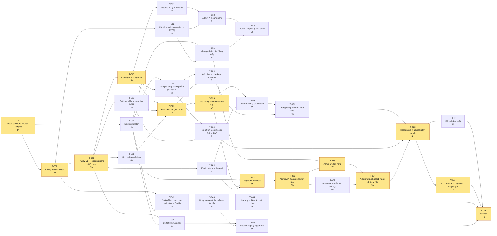

# Tasks — BKStudio

> **File này được sinh tự động** từ `docs/tasks.py` (`python3 docs/tasks.py --render`). Sửa dữ liệu trong `tasks.py`, không sửa tay file này.
> Trạng thái task theo dõi bằng cột *Status*: `todo` → `doing` → `done` (cập nhật trong `tasks.py`).

## Tổng quan

| Nhóm | Giờ | Task |
|---|---|---|
| M0 — Setup | 19 | T-001, T-002, T-003, T-004, T-005 |
| M1 — Catalog & đăng nhập admin | 42 | T-010, T-011, T-012, T-013, T-014, T-015, T-016 |
| M2 — Đơn hàng, thanh toán, hàng đợi | 42 | T-020, T-021, T-022, T-023, T-024, T-025, T-026, T-027, T-028 |
| M3 — Giao diện khách & admin | 31 | T-030, T-031, T-032, T-033, T-034, T-035 |
| M4 — Bảo mật, deploy, launch | 30 | T-040, T-041, T-042, T-043, T-044, T-045, T-046 |
| M5 — Làm ngay sau launch | 3 | T-050, T-051 |
| P1 — Chỉ làm nếu còn thời gian | 13 | T-060, T-061, T-062, T-063 |
| **Cần để launch** | **164** | M0–M4 |

**Critical path** (chuỗi phụ thuộc dài nhất, 66 giờ): T-001 → T-002 → T-003 → T-010 → T-022 → T-023 → T-025 → T-026 → T-033 → T-034 → T-035 → T-041 → T-046

## Sơ đồ phụ thuộc (task cần để launch)

Ô màu vàng = critical path. Vì chỉ có 1 người làm, các task **không** chạy song song thật sự; "song song được" nghĩa là **đổi thứ tự thoải mái** (vd đang kẹt backend thì chuyển sang task frontend không phụ thuộc).

## Chi tiết task

### M0 — Setup

#### T-001 · Repo structure & local Postgres
- **Ưu tiên:** P0 · **Ước lượng:** 3 giờ · **Phụ thuộc:** — · **Status:** done · **Thực tế:** 3 giờ
- **Phạm vi:** Thư mục `backend/ frontend/ infra/`; `.editorconfig`; `.env.example`; `infra/docker-compose.dev.yml` chạy PostgreSQL 16 + MinIO (giả lập R2).
- **File / module:** infra/docker-compose.dev.yml, .env.example
- **Nghiệm thu:** `docker compose -f infra/docker-compose.dev.yml up` chạy được Postgres + MinIO; README có hướng dẫn chạy local.
- **Test:** Kết nối psql thành công.
- **Rủi ro / câu hỏi:** Docker Desktop trên Windows cần WSL2.

#### T-002 · Spring Boot skeleton
- **Ưu tiên:** P0 · **Ước lượng:** 4 giờ · **Phụ thuộc:** T-001 · **Status:** todo
- **Phạm vi:** Maven, Java 25 (ADR-0011), package theo module (catalog, order, queue, payment, notification, admin, shared); `/api/health`; `@RestControllerAdvice` → ProblemDetail có `code` + `requestId`; filter gắn `X-Request-Id`; log JSON.
- **File / module:** backend/pom.xml, backend/src/main/java/.../shared/*
- **Nghiệm thu:** `./mvnw verify` xanh; `GET /api/health` trả `{status:UP}`; lỗi trả đúng định dạng API_SPEC §1.
- **Test:** Unit test cho exception handler; MockMvc test health.
- **Rủi ro / câu hỏi:** Chọn đúng bản Spring Boot ổn định mới nhất.

#### T-003 · Flyway V1 + Testcontainers + DB tests
- **Ưu tiên:** P0 · **Ước lượng:** 5 giờ · **Phụ thuộc:** T-002 · **Status:** todo
- **Phạm vi:** Chuyển `docs/schema-draft.sql` thành `V1__init.sql` (đặt tên constraint tường minh); base class integration test với Testcontainers; viết lại 17 tình huống trong DATABASE.md §5 thành test.
- **File / module:** backend/src/main/resources/db/migration/V1__init.sql, backend/src/test/.../DbConstraintsIT.java
- **Nghiệm thu:** 17 test DB xanh trên PostgreSQL thật trong container.
- **Test:** Integration test (Testcontainers).
- **Rủi ro / câu hỏi:** Testcontainers trên Windows cần Docker chạy.

#### T-004 · Next.js skeleton
- **Ưu tiên:** P0 · **Ước lượng:** 4 giờ · **Phụ thuộc:** T-001 · **Status:** todo
- **Phạm vi:** Next.js App Router + TypeScript + Tailwind; layout chung; API client gọi `/api` (rewrite sang backend khi dev); error boundary hiển thị requestId; ESLint + Prettier.
- **File / module:** frontend/*
- **Nghiệm thu:** `npm run build` thành công; trang chủ gọi được `/api/health` qua proxy.
- **Test:** `npm run lint` + build.
- **Rủi ro / câu hỏi:** Học App Router (server vs client component).

#### T-005 · CI (GitHub Actions)
- **Ưu tiên:** P0 · **Ước lượng:** 3 giờ · **Phụ thuộc:** T-003, T-004 · **Status:** todo
- **Phạm vi:** Workflow: backend `mvn verify` (có Testcontainers), frontend lint + build, gitleaks quét secret; Dependabot cho Maven + npm.
- **File / module:** .github/workflows/ci.yml, .github/dependabot.yml
- **Nghiệm thu:** PR mở ra thì CI chạy và xanh; commit thử 1 secret giả bị gitleaks bắt.
- **Test:** Chính CI.
- **Rủi ro / câu hỏi:** —

### M1 — Catalog & đăng nhập admin

#### T-010 · Catalog API công khai
- **Ưu tiên:** P0 · **Ước lượng:** 5 giờ · **Phụ thuộc:** T-003 · **Status:** todo
- **Phạm vi:** Entity + repository product/variant/image; `GET /api/products` (chỉ ACTIVE), `GET /api/products/{slug}` (ACTIVE + UNLISTED, cờ `unlisted`); tình trạng có sẵn / làm theo đơn (tôn trọng quota); không lộ số tồn kho.
- **File / module:** backend/.../catalog/*
- **Nghiệm thu:** Đúng hợp đồng API_SPEC §2; UNLISTED không bao giờ xuất hiện trong danh sách.
- **Test:** Integration test cho list/detail/UNLISTED/quota hết.
- **Rủi ro / câu hỏi:** —

#### T-011 · Pipeline xử lý & lưu ảnh
- **Ưu tiên:** P0 · **Ước lượng:** 6 giờ · **Phụ thuộc:** T-010 · **Status:** todo
- **Phạm vi:** Kiểm tra magic bytes, ≤10 MB, ≤8000×8000; decode → WebP 400/1000/2000 (mất EXIF); upload R2 (S3 SDK; MinIO khi dev); key ngẫu nhiên; xoá ảnh.
- **File / module:** backend/.../catalog/image/*
- **Nghiệm thu:** Ảnh JPEG/PNG/WebP hợp lệ → 3 file WebP trên storage; file `.php` đổi đuôi `.jpg` bị từ chối; ảnh có GPS EXIF → output không còn EXIF.
- **Test:** Unit test với file mẫu (hợp lệ, giả mạo, quá lớn); integration test với MinIO.
- **Rủi ro / câu hỏi:** Thư viện WebP cho Java (cần chọn: TwelveMonkeys/webp-imageio hoặc gọi libvips).

#### T-012 · Xác thực admin (session + TOTP)
- **Ưu tiên:** P0 · **Ước lượng:** 8 giờ · **Phụ thuộc:** T-002 · **Status:** todo
- **Phạm vi:** Spring Security: login 2 bước (mật khẩu Argon2id → TOTP), đổi session ID, CSRF cookie→header, timeout 30 phút/12 giờ, khoá tạm 5 lần sai/15 phút, 10 mã khôi phục, secret TOTP mã hoá AES-GCM; lệnh CLI tạo admin đầu tiên.
- **File / module:** backend/.../admin/auth/*
- **Nghiệm thu:** Không có TOTP thì không vào được `/api/admin/**`; sai 5 lần bị khoá; request thiếu CSRF bị 403; mã khôi phục dùng 1 lần.
- **Test:** Integration test cho từng tiêu chí trên.
- **Rủi ro / câu hỏi:** Phần khó nhất về bảo mật — đọc kỹ tài liệu Spring Security.

#### T-013 · Admin API sản phẩm
- **Ưu tiên:** P0 · **Ước lượng:** 5 giờ · **Phụ thuộc:** T-011, T-012 · **Status:** todo
- **Phạm vi:** CRUD product/variant (giá, tồn kho, bật làm theo đơn, quota, `version`); UNLISTED tự gắn hậu tố slug ngẫu nhiên; upload/sắp xếp/sửa alt/xoá ảnh.
- **File / module:** backend/.../catalog/admin/*
- **Nghiệm thu:** Đúng API_SPEC §3 Sản phẩm; sửa với `version` cũ → 409 VERSION_CONFLICT.
- **Test:** Integration test.
- **Rủi ro / câu hỏi:** —

#### T-014 · Trang catalog & sản phẩm (frontend)
- **Ưu tiên:** P0 · **Ước lượng:** 6 giờ · **Phụ thuộc:** T-004, T-010 · **Status:** todo
- **Phạm vi:** Trang danh sách (lọc series), trang chi tiết (gallery `srcset`, chọn tỉ lệ, có sẵn / làm theo đơn + tháng dự kiến); render trên server; thẻ Open Graph; `noindex` cho UNLISTED; sitemap chỉ ACTIVE.
- **File / module:** frontend/app/(shop)/*
- **Nghiệm thu:** Dán link sản phẩm vào trình kiểm tra OG (vd Facebook Sharing Debugger hoặc opengraph.xyz) thấy ảnh + tên + giá.
- **Test:** Kiểm tra thủ công + build.
- **Rủi ro / câu hỏi:** —

#### T-015 · Khung admin UI + đăng nhập
- **Ưu tiên:** P0 · **Ước lượng:** 5 giờ · **Phụ thuộc:** T-004, T-012 · **Status:** todo
- **Phạm vi:** Trang login + nhập TOTP + mã khôi phục; layout admin; chặn route khi chưa đăng nhập; xử lý CSRF trong API client.
- **File / module:** frontend/app/admin/*
- **Nghiệm thu:** Đăng nhập đủ 2 bước vào được admin; hết session tự về trang login.
- **Test:** Kiểm tra thủ công; E2E ở T-041.
- **Rủi ro / câu hỏi:** —

#### T-016 · Admin UI quản lý sản phẩm
- **Ưu tiên:** P0 · **Ước lượng:** 7 giờ · **Phụ thuộc:** T-013, T-015 · **Status:** todo
- **Phạm vi:** Danh sách + form sản phẩm, biến thể, upload ảnh kéo-thả + sắp xếp, chọn trạng thái (DRAFT/ACTIVE/UNLISTED/ARCHIVED), nút "Sao chép link" cho commission.
- **File / module:** frontend/app/admin/products/*
- **Nghiệm thu:** Tạo được sản phẩm thật từ đầu đến khi hiện trên catalog; tạo được sản phẩm commission và copy link.
- **Test:** Kiểm tra thủ công.
- **Rủi ro / câu hỏi:** UI upload ảnh tốn thời gian hơn dự kiến.

### M2 — Đơn hàng, thanh toán, hàng đợi

#### T-020 · Settings, điều khoản, link MXH
- **Ưu tiên:** P0 · **Ước lượng:** 3 giờ · **Phụ thuộc:** T-003 · **Status:** todo
- **Phạm vi:** `app_setting` (sức chứa mặc định, tên miền link cho phép, link MXH…), `terms_document`; `GET /api/terms/current`, `GET /api/site-info`; admin GET/PUT settings, đăng điều khoản mới.
- **File / module:** backend/.../shared/settings/*
- **Nghiệm thu:** Đúng API_SPEC.
- **Test:** Integration test.
- **Rủi ro / câu hỏi:** —

#### T-021 · Module hàng đợi slot
- **Ưu tiên:** P0 · **Ước lượng:** 4 giờ · **Phụ thuộc:** T-003 · **Status:** todo
- **Phạm vi:** Tự tạo `production_month`; ước tính tháng; cấp slot (`FOR UPDATE SKIP LOCKED`) và trả slot; admin xem/sửa sức chứa (≥ allocated).
- **File / module:** backend/.../queue/*
- **Nghiệm thu:** 2 lần cấp slot song song không bao giờ vượt capacity; giảm capacity dưới allocated bị từ chối.
- **Test:** Integration test có chạy song song (2 thread).
- **Rủi ro / câu hỏi:** —

#### T-022 · API checkout (tạo đơn)
- **Ưu tiên:** P0 · **Ước lượng:** 7 giờ · **Phụ thuộc:** T-010, T-020, T-021 · **Status:** todo
- **Phạm vi:** `POST /api/orders`: validate, 1 loại/đơn, giá lấy từ DB, trừ kho/quota có điều kiện, `Idempotency-Key`, sinh `public_code` + token (lưu hash), lưu bằng chứng điều khoản; rate limit 5 đơn/IP/giờ.
- **File / module:** backend/.../order/checkout/*
- **Nghiệm thu:** Gửi giá sai từ client không ảnh hưởng; retry cùng key → cùng đơn; 2 người mua món cuối → 1 người nhận OUT_OF_STOCK.
- **Test:** Integration test gồm test song song.
- **Rủi ro / câu hỏi:** Thiết kế transaction đúng là trọng tâm học.

#### T-023 · Máy trạng thái đơn + audit log
- **Ưu tiên:** P0 · **Ước lượng:** 5 giờ · **Phụ thuộc:** T-022 · **Status:** todo
- **Phạm vi:** `OrderStateMachine` với bảng chuyển hợp lệ cho 2 loại đơn; optimistic lock; ghi audit; hook tạo email outbox trong cùng transaction.
- **File / module:** backend/.../order/state/*
- **Nghiệm thu:** Mọi cặp (trạng thái, hành động) không hợp lệ → INVALID_TRANSITION.
- **Test:** Unit test dạng bảng cho toàn bộ cặp chuyển trạng thái.
- **Rủi ro / câu hỏi:** —

#### T-024 · Email outbox + Resend
- **Ưu tiên:** P0 · **Ước lượng:** 6 giờ · **Phụ thuộc:** T-003 · **Status:** todo
- **Phạm vi:** Bảng outbox + `dedupe_key`; job gửi mỗi phút, backoff, tối đa 8 lần; interface `EmailSender` (Resend + bản log-only khi dev); template: nhận đơn, link thanh toán, xác nhận, hoàn thiện, nhắc hạn, mất cọc, đã gửi hàng, link tra cứu.
- **File / module:** backend/.../notification/*
- **Nghiệm thu:** Resend lỗi tạm thời → email vẫn được gửi sau; cùng `dedupe_key` không gửi 2 lần.
- **Test:** Integration test với `EmailSender` giả.
- **Rủi ro / câu hỏi:** Template email HTML hiển thị khác nhau giữa Gmail/Outlook.

#### T-025 · Payment requests
- **Ưu tiên:** P0 · **Ước lượng:** 5 giờ · **Phụ thuộc:** T-021, T-023, T-024 · **Status:** todo
- **Phạm vi:** Tạo yêu cầu (kiểm tra tên miền cho phép, `https`), hạn 48 giờ; xác nhận idempotent (bắt buộc mã tham chiếu; cọc → cấp slot; FULL/BALANCE → PAID_IN_FULL); huỷ yêu cầu.
- **File / module:** backend/.../payment/*
- **Nghiệm thu:** Bấm xác nhận 2 lần chỉ có 1 hiệu ứng; mã invoice trùng → lỗi rõ ràng; link ngoài danh sách → 400.
- **Test:** Integration test.
- **Rủi ro / câu hỏi:** —

#### T-026 · Admin API hành động đơn hàng
- **Ưu tiên:** P0 · **Ước lượng:** 5 giờ · **Phụ thuộc:** T-025 · **Status:** todo
- **Phạm vi:** Danh sách/lọc/chi tiết (kèm `allowedActions`); start-production, mark-finished (tạo BALANCE), ship, complete, cancel-by-shop (+ trả slot/kho/quota), ghi chú.
- **File / module:** backend/.../order/admin/*
- **Nghiệm thu:** Đúng API_SPEC §3 Đơn hàng.
- **Test:** Integration test cho từng hành động.
- **Rủi ro / câu hỏi:** —

#### T-027 · Job hết hạn / nhắc hạn / mất cọc
- **Ưu tiên:** P0 · **Ước lượng:** 4 giờ · **Phụ thuộc:** T-026 · **Status:** todo
- **Phạm vi:** Hết hạn thanh toán (nhả kho/quota/huỷ đơn), nhắc trả nốt 7 ngày & 1 ngày, FORFEITED sau 30 ngày; mỗi đơn 1 transaction; chạy lại an toàn.
- **File / module:** backend/.../order/jobs/*
- **Nghiệm thu:** Chạy job 2 lần liên tiếp không tạo thay đổi/email trùng.
- **Test:** Integration test với đồng hồ giả (`Clock` inject được).
- **Rủi ro / câu hỏi:** —

#### T-028 · API đơn hàng phía khách
- **Ưu tiên:** P0 · **Ước lượng:** 3 giờ · **Phụ thuộc:** T-023, T-024 · **Status:** todo
- **Phạm vi:** `GET /api/orders/{token}`, `POST …/cancel` theo quy tắc, `POST /api/orders/lookup` (luôn 202, gửi link qua email).
- **File / module:** backend/.../order/customer/*
- **Nghiệm thu:** Token sai → 404; lookup không bao giờ trả dữ liệu đơn trực tiếp.
- **Test:** Integration test.
- **Rủi ro / câu hỏi:** —

### M3 — Giao diện khách & admin

#### T-030 · Giỏ hàng + checkout (frontend)
- **Ưu tiên:** P0 · **Ước lượng:** 7 giờ · **Phụ thuộc:** T-014, T-022 · **Status:** todo
- **Phạm vi:** Giỏ hàng lưu localStorage; tách giỏ trộn 2 loại; form khách + địa chỉ (chọn quốc gia); checkbox điều khoản (hiện rõ cọc không hoàn); idempotency key; màn hình thành công.
- **File / module:** frontend/app/(shop)/cart, checkout
- **Nghiệm thu:** Đặt được đơn hàng sẵn và đơn làm theo đơn; bấm "Đặt hàng" 2 lần chỉ tạo 1 đơn.
- **Test:** E2E ở T-041.
- **Rủi ro / câu hỏi:** —

#### T-031 · Trang trạng thái đơn + tra cứu
- **Ưu tiên:** P0 · **Ước lượng:** 4 giờ · **Phụ thuộc:** T-028, T-030 · **Status:** todo
- **Phạm vi:** Trang `/orders/{token}`: trạng thái, link thanh toán đang mở, tháng sản xuất, vận đơn, nút huỷ; trang tra cứu bằng mã + email.
- **File / module:** frontend/app/(shop)/orders/*
- **Nghiệm thu:** Khách thấy đúng link thanh toán và hạn; huỷ ở QUEUED có hộp xác nhận mất cọc.
- **Test:** E2E ở T-041.
- **Rủi ro / câu hỏi:** —

#### T-032 · Trang tĩnh: Commission, Policy, FAQ
- **Ưu tiên:** P0 · **Ước lượng:** 3 giờ · **Phụ thuộc:** T-014, T-020 · **Status:** todo
- **Phạm vi:** Trang Commission (quy trình + link Reddit/FB/Instagram/X), Terms/Policy (lấy từ API), FAQ, footer có link MXH, trang Privacy.
- **File / module:** frontend/app/(shop)/commission, policy, faq
- **Nghiệm thu:** Link MXH lấy từ settings, đổi trong admin là đổi trên web.
- **Test:** Kiểm tra thủ công.
- **Rủi ro / câu hỏi:** Nội dung điều khoản do chủ shop viết (O-2).

#### T-033 · Admin UI đơn hàng
- **Ưu tiên:** P0 · **Ước lượng:** 8 giờ · **Phụ thuộc:** T-015, T-026 · **Status:** todo
- **Phạm vi:** Danh sách + lọc + tìm; chi tiết đơn với lịch sử audit; nút hành động theo `allowedActions`; form tạo yêu cầu thanh toán, xác nhận (nhập mã), gửi hàng.
- **File / module:** frontend/app/admin/orders/*
- **Nghiệm thu:** Đi hết vòng đời 1 đơn làm theo đơn chỉ bằng UI admin.
- **Test:** E2E ở T-041.
- **Rủi ro / câu hỏi:** Màn hình phức tạp nhất phía frontend.

#### T-034 · Admin UI dashboard, hàng đợi, cài đặt
- **Ưu tiên:** P0 · **Ước lượng:** 5 giờ · **Phụ thuộc:** T-033, T-027 · **Status:** todo
- **Phạm vi:** Dashboard việc cần làm (chờ gửi link, chờ xác nhận, sắp quá hạn, email lỗi); trang hàng đợi theo tháng + sửa sức chứa; trang cài đặt (link MXH, tên miền cho phép, điều khoản).
- **File / module:** frontend/app/admin/(dashboard|queue|settings)
- **Nghiệm thu:** Mọi đơn cần hành động đều xuất hiện trên dashboard.
- **Test:** Kiểm tra thủ công.
- **Rủi ro / câu hỏi:** —

#### T-035 · Responsive + accessibility cơ bản
- **Ưu tiên:** P0 · **Ước lượng:** 4 giờ · **Phụ thuộc:** T-031, T-032, T-034 · **Status:** todo
- **Phạm vi:** Kiểm tra mọi trang ở 375px / 768px / 1280px; focus bàn phím; alt ảnh; tương phản màu.
- **File / module:** frontend/*
- **Nghiệm thu:** Không có cuộn ngang ở 375px; Lighthouse Accessibility ≥ 90 trang chủ + sản phẩm.
- **Test:** Lighthouse.
- **Rủi ro / câu hỏi:** —

### M4 — Bảo mật, deploy, launch

#### T-040 · Rà soát bảo mật
- **Ưu tiên:** P0 · **Ước lượng:** 4 giờ · **Phụ thuộc:** T-035 · **Status:** todo
- **Phạm vi:** Đi hết checklist SECURITY.md §5; CSP + header qua Caddy; kiểm tra rate limit; xem lại log không chứa dữ liệu cá nhân.
- **File / module:** infra/Caddyfile, docs/SECURITY.md
- **Nghiệm thu:** Mọi mục checklist ✅ có bằng chứng.
- **Test:** Kiểm tra thủ công + securityheaders.com.
- **Rủi ro / câu hỏi:** —

#### T-041 · E2E test các luồng chính (Playwright)
- **Ưu tiên:** P0 · **Ước lượng:** 6 giờ · **Phụ thuộc:** T-035 · **Status:** todo
- **Phạm vi:** 3 luồng: mua hàng sẵn → ship; làm theo đơn: cọc → slot → hoàn thiện → trả nốt → ship; commission UNLISTED quota 1. Chạy trong CI với docker compose.
- **File / module:** e2e/*
- **Nghiệm thu:** 3 luồng xanh trong CI.
- **Test:** Chính nó.
- **Rủi ro / câu hỏi:** E2E trong CI dễ chập chờn.

#### T-042 · Dockerfile + compose production + Caddy
- **Ưu tiên:** P0 · **Ước lượng:** 4 giờ · **Phụ thuộc:** T-002, T-004 · **Status:** todo
- **Phạm vi:** Dockerfile nhiều tầng cho backend & frontend (Next.js standalone); `infra/docker-compose.yml` (caddy, frontend, backend, postgres, mạng nội bộ, giới hạn log); Caddyfile.
- **File / module:** backend/Dockerfile, frontend/Dockerfile, infra/*
- **Nghiệm thu:** `docker compose up` trên máy local chạy được toàn bộ hệ thống như production.
- **Test:** Chạy thử local.
- **Rủi ro / câu hỏi:** —

#### T-043 · Dựng server & tên miền ⚠️ tốn tiền
- **Ưu tiên:** P0 · **Ước lượng:** 5 giờ · **Phụ thuộc:** T-042 · **Status:** todo
- **Phạm vi:** (Cần chủ dự án duyệt chi phí) Thuê VPS theo quy tắc ADR-0005; SSH key, tắt mật khẩu/root, firewall, fail2ban, auto update; mua domain; DNS Cloudflare; bucket R2 + subdomain cdn; domain Resend + SPF/DKIM/DMARC.
- **File / module:** docs/DEPLOYMENT.md
- **Nghiệm thu:** HTTPS hoạt động; mail-tester ≥ 9/10; port 5432 không truy cập được từ ngoài.
- **Test:** Kiểm tra thủ công.
- **Rủi ro / câu hỏi:** Hetzner từ chối xác minh (R9); giá Singapore vượt ngân sách.

#### T-044 · Backup + diễn tập khôi phục
- **Ưu tiên:** P0 · **Ước lượng:** 4 giờ · **Phụ thuộc:** T-043 · **Status:** todo
- **Phạm vi:** Script pg_dump → mã hoá → R2 bucket riêng, xoay vòng 14 ngày + 8 tuần; cron 03:00 SGT; email cảnh báo khi lỗi; khôi phục thử sang máy khác và ghi thời gian.
- **File / module:** infra/backup/*, docs/DEPLOYMENT.md
- **Nghiệm thu:** Khôi phục thành công 1 bản backup, ghi lại thời gian thực tế.
- **Test:** Diễn tập.
- **Rủi ro / câu hỏi:** —

#### T-045 · Pipeline deploy + giám sát
- **Ưu tiên:** P0 · **Ước lượng:** 3 giờ · **Phụ thuộc:** T-005, T-043 · **Status:** todo
- **Phạm vi:** CI build image → GHCR; script deploy (`pull && up -d`); uptime monitor `/api/health`; rollback về tag trước.
- **File / module:** .github/workflows/deploy.yml, infra/deploy.sh
- **Nghiệm thu:** Deploy 1 lệnh; rollback thử thành công; tắt backend → nhận email cảnh báo.
- **Test:** Thử thật.
- **Rủi ro / câu hỏi:** —

#### T-046 · Launch
- **Ưu tiên:** P0 · **Ước lượng:** 4 giờ · **Phụ thuộc:** T-040, T-041, T-044, T-045 · **Status:** todo
- **Phạm vi:** Nhập sản phẩm thật, đặt sức chứa, đăng điều khoản; đặt thử 1 đơn thật trọn vòng (giá nhỏ); chạy launch checklist (ROADMAP §4); mở bán.
- **File / module:** —
- **Nghiệm thu:** Mọi tiêu chí launch ✅.
- **Test:** Đơn thật thử nghiệm.
- **Rủi ro / câu hỏi:** —

### M5 — Làm ngay sau launch

#### T-050 · Job tự đóng đơn + ẩn danh dữ liệu cũ
- **Ưu tiên:** P0 (làm sau launch được) · **Ước lượng:** 2 giờ · **Phụ thuộc:** T-027 · **Status:** todo
- **Phạm vi:** SHIPPED > 30 ngày → COMPLETED; đơn kết thúc > 2 năm → ẩn danh.
- **File / module:** backend/.../order/jobs/*
- **Nghiệm thu:** Chạy lại an toàn.
- **Test:** Integration test với đồng hồ giả.
- **Rủi ro / câu hỏi:** Không gấp: dữ liệu cần ẩn danh sớm nhất sau 2 năm.

#### T-051 · Nút "Chuyển thành hàng sẵn" cho đơn FORFEITED
- **Ưu tiên:** P0 (làm sau launch được) · **Ước lượng:** 1 giờ · **Phụ thuộc:** T-033 · **Status:** todo
- **Phạm vi:** Nút trên chi tiết đơn → `stock_qty + 1`.
- **File / module:** backend + frontend admin
- **Nghiệm thu:** Hoạt động 1 lần duy nhất mỗi đơn.
- **Test:** Integration test.
- **Rủi ro / câu hỏi:** Không gấp: đơn FORFEITED đầu tiên xuất hiện sớm nhất ~1 tháng sau launch; tạm thời sửa tồn kho tay.

### P1 — Chỉ làm nếu còn thời gian

| ID | Task | Giờ | Phụ thuộc |
|---|---|---|---|
| T-060 | Cloudflare Turnstile chống bot ở checkout | 2 | T-030 |
| T-061 | Sentry (lỗi backend + frontend) | 2 | T-045 |
| T-062 | Mã giảm giá đơn giản | 6 | T-022, T-033 |
| T-063 | Dời slot sang tháng khác | 3 | T-034 |

## Việc của chủ shop (không tính giờ code)

| ID | Việc | Hạn |
|---|---|---|
| O-1 | Đọc ToS / hỏi support Artistree về hàng vật lý (rủi ro R1) | Trước T-046 |
| O-2 | Viết nội dung Terms, Policy (ship, cọc không hoàn, thời gian chờ), Privacy, FAQ | Trước T-032 |
| O-3 | Chụp ảnh + viết mô tả cho các sản phẩm đầu tiên | Trước T-046 |
| O-4 | Xem giá VPS Singapore, chọn tên miền, duyệt chi phí | Trước T-043 |
| O-5 | Cung cấp 4 link mạng xã hội | Trước T-032 (hoặc tự nhập trong admin) |
