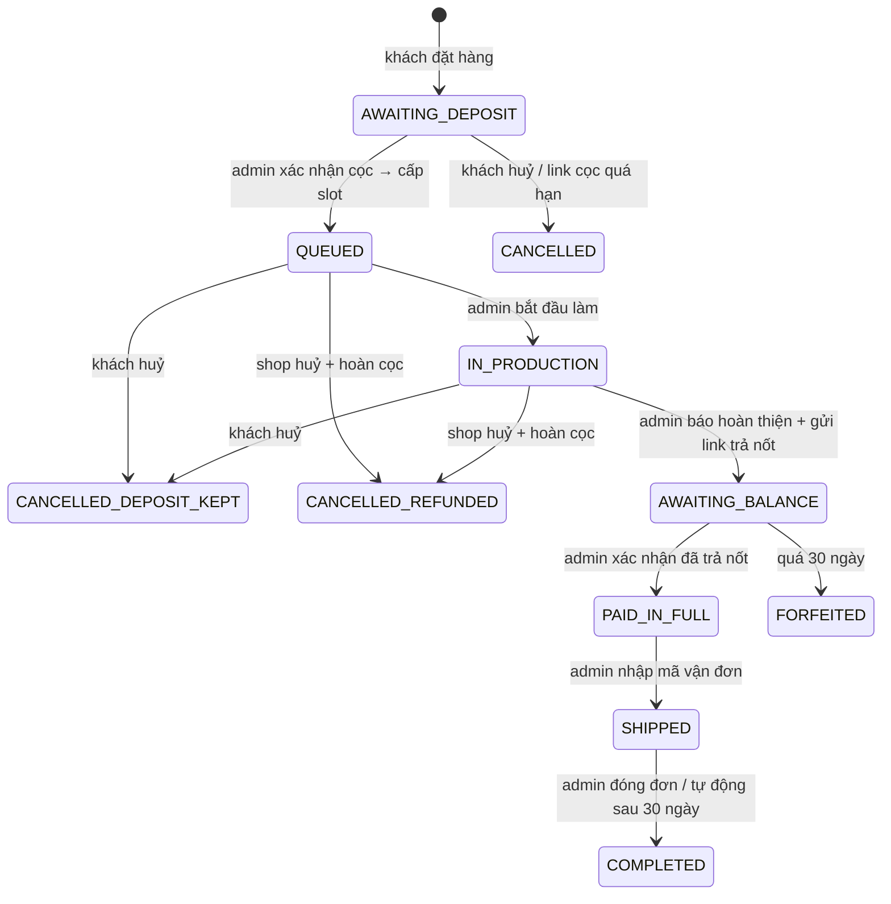
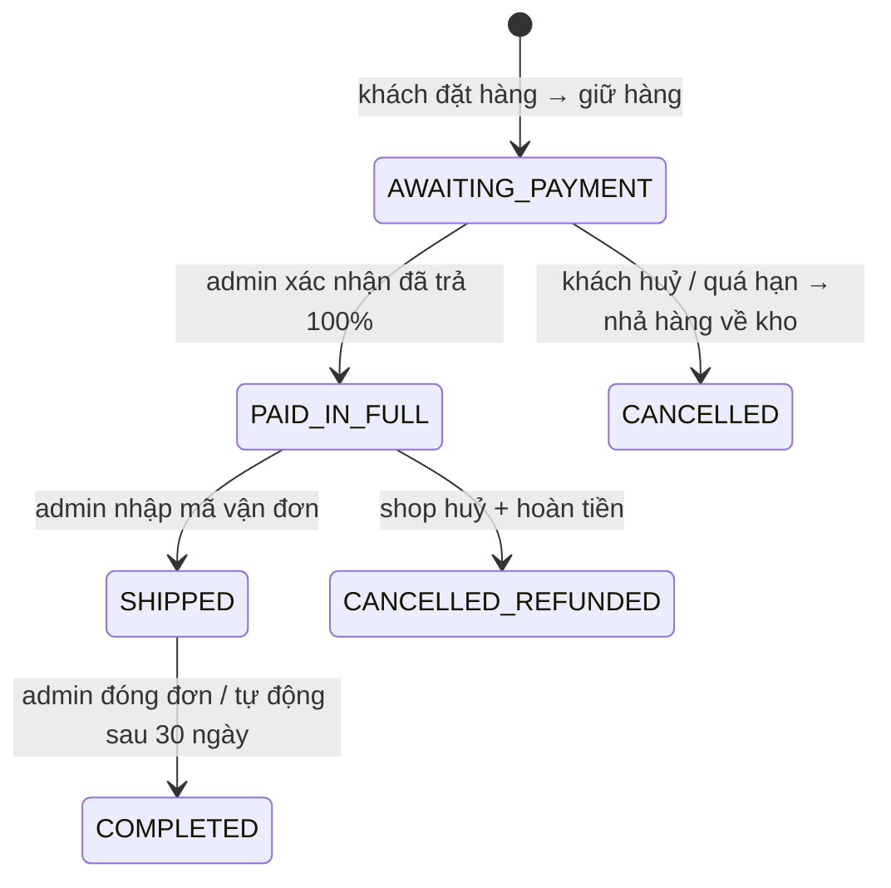
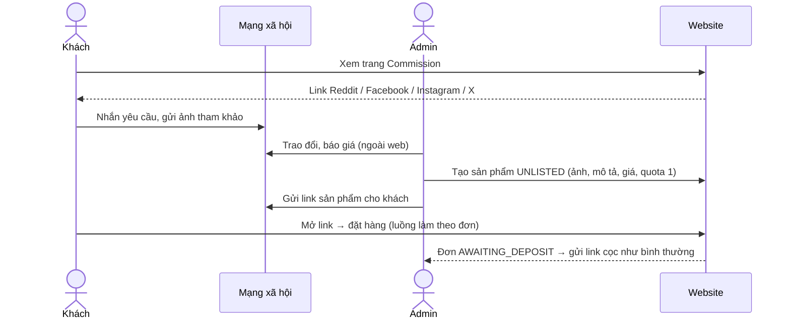
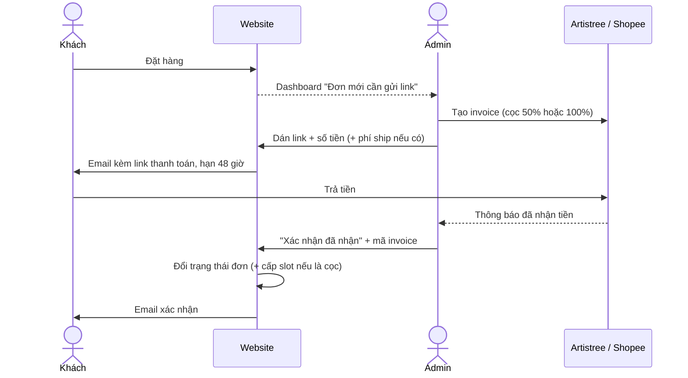

# Workflows — BKStudio

> Trạng thái: **Đã duyệt (Phase 3)** · Cập nhật: 2026-10-18
> Ký hiệu: ❓ = cần chủ shop xác nhận.

## 1. Máy trạng thái đơn hàng

### 1.1 Hàng làm theo đơn (`MADE_TO_ORDER`)

### 1.2 Hàng có sẵn (`IN_STOCK`)

### 1.3 Quy tắc chung
- Mọi chuyển trạng thái đi qua **một service duy nhất** (`OrderStateMachine`) có bảng chuyển hợp lệ; chuyển sai → lỗi `INVALID_TRANSITION` (409).
- Mỗi lần chuyển: kiểm tra `version` (optimistic lock), ghi `audit_log`, tạo email vào `email_outbox` **trong cùng 1 transaction** → không có chuyện đổi trạng thái mà quên gửi email, hoặc gửi email mà trạng thái không đổi.
- `FORFEITED` / `CANCELLED_*` / `COMPLETED` là trạng thái cuối.

## 2. Đặt hàng (checkout)

**Quy tắc giỏ hàng:**
- Mỗi dòng trong giỏ chọn rõ: **Có sẵn** ("ship trong ~X ngày") hoặc **Làm theo đơn** ("dự kiến bắt đầu làm: tháng Y").
- **Một đơn chỉ chứa 1 loại** (toàn hàng sẵn hoặc toàn làm theo đơn), vì cách thanh toán khác nhau (100% vs cọc 50%). Giỏ trộn 2 loại → giao diện tách thành 2 lần checkout.
- Tối đa 5 chiếc mỗi dòng.

**Luồng (1 transaction DB):**
1. Frontend tạo `idempotencyKey` (UUID) khi mở trang checkout; gửi kèm request.
2. Backend kiểm tra dữ liệu, **lấy giá từ DB** (không bao giờ tin giá client gửi lên), kiểm tra `termsVersion` khách đồng ý = phiên bản hiện hành.
3. Hàng sẵn: trừ kho bằng `UPDATE … WHERE stock_qty >= n`. Không đủ → `OUT_OF_STOCK` (409), rollback toàn bộ.
4. Tạo `customer_order` + `order_item`, sinh `public_code` và token truy cập ngẫu nhiên 32 byte (chỉ lưu hash).
5. Ghi email "Đã nhận đơn" vào outbox (kèm link `/orders/{token}`) — đã làm ở T-024 (`CheckoutService` gọi `OutboxWriter.enqueue` trong cùng transaction; replay không ghi lại).
6. Trả về mã đơn + link (chỉ lần tạo đầu, vì DB chỉ lưu hash của token). Nếu cùng `idempotencyKey` gửi lại → `200` với đơn đã tạo nhưng `orderUrl = null` (link nằm trong email). Cọc làm tròn lên nửa cent: `deposit = (subtotal + 1) / 2`, phần còn lại = `subtotal − deposit`.

**Lưu ý về thời gian chờ dự kiến:** con số hiển thị lúc đặt chỉ là **ước tính**; slot thật được cấp khi admin xác nhận cọc (mục 4). Email xác nhận cọc báo tháng chính thức. Câu này phải hiện rõ ở trang sản phẩm và trong điều khoản.

## 2b. Commission

- Sau khi khách đặt: **hoàn toàn giống hàng làm theo đơn** (cọc 50% → slot → làm → trả nốt → ship). Không cần code luồng riêng.
- Sản phẩm `UNLISTED`: không hiện trong danh sách, tìm kiếm, sitemap; trang có `noindex`. Slug tự gắn hậu tố ngẫu nhiên để khó đoán.
- `made_to_order_quota = 1` → khi khách đặt, quota về 0, người khác mở link sẽ thấy "Đã có người đặt". Đơn bị huỷ/hết hạn trước khi cọc → quota +1 trở lại.
- Làm xong, admin có thể chuyển sản phẩm sang `ACTIVE` để khoe trong catalog (bỏ quota hoặc đặt quota mới), hoặc `ARCHIVED`.
- Q10: commission chiếm slot như hàng làm theo đơn (mặc định).

## 3. Thanh toán (thủ công — ADR-0008)

- **Hạn thanh toán: 48 giờ kể từ lúc gửi link** (cả cọc và hàng sẵn). Trước khi admin gửi link, hàng sẵn / quota vẫn được giữ — dashboard nhắc admin gửi link sớm.
- Link chỉ được chấp nhận nếu thuộc tên miền cho phép (`artistree.io`, `shopee.sg`, `shopee.com.my`… — danh sách trong cấu hình) → chặn dán nhầm/độc link.
- Phí ship: kênh Artistree → admin nhập `shipping_cents` khi tạo yêu cầu `FULL`/`BALANCE`. Kênh Shopee + mua hộ → phí ship = 0 trên đơn.
- Quá hạn: job đổi `payment_request` → `EXPIRED`, đơn → `CANCELLED`, hàng sẵn được cộng lại kho, quota làm theo đơn được cộng lại.
- Huỷ đơn bởi shop sau khi đã nhận tiền: admin hoàn tiền trên nền tảng ngoài, rồi bấm "Huỷ + đã hoàn tiền" kèm mã hoàn tiền (lưu vào `audit_log`).

## 4. Hàng đợi slot
- Mỗi tháng có `capacity` (admin đặt). Tháng chưa có dòng → tự tạo với sức chứa mặc định trong `app_setting`.
- **Cấp slot khi cọc được xác nhận**, mỗi chiếc 1 slot: tìm tháng sớm nhất còn chỗ, khoá dòng tháng đó (`FOR UPDATE SKIP LOCKED`), tăng `allocated`, tạo `queue_entry`.
- Thứ tự trong tháng: theo thời điểm xác nhận cọc (FIFO).
- **Ước tính hiển thị cho khách** = tháng sớm nhất còn chỗ cho số lượng họ chọn (chỉ đọc, không giữ chỗ).
- Huỷ đơn đang `QUEUED` → `allocated - 1`, slot trả lại tháng đó.
- Admin giảm `capacity` của 1 tháng: không được nhỏ hơn `allocated` (DB chặn). Muốn dời đơn sang tháng sau → thao tác "Dời slot" riêng (P1).

## 5. Trả nốt, nhắc hạn, mất cọc
1. Admin bấm "Hoàn thiện" (`IN_PRODUCTION → AWAITING_BALANCE`) và tạo yêu cầu `BALANCE` (50% + phí ship nếu kênh Artistree), `due_at = now + 30 ngày`.
2. Email báo hoàn thiện kèm ảnh + link trả nốt.
3. Job nhắc: **7 ngày** và **1 ngày** trước hạn (`dedupe_key` đảm bảo mỗi mốc gửi đúng 1 lần).
4. Quá hạn → `FORFEITED`, email thông báo. Admin có nút **"Chuyển thành hàng sẵn"** → `stock_qty + 1` cho biến thể đó.

## 6. Giao hàng
- Admin nhập hãng + mã vận đơn (`PAID_IN_FULL → SHIPPED`) → email cho khách kèm link tra cứu (nếu biết mẫu URL của hãng).
- `SHIPPED → COMPLETED`: admin đóng đơn, hoặc job tự đóng sau 30 ngày.

## 7. Khách tra cứu đơn
- Cách chính: link bí mật trong email `/orders/{token}`.
- Mất email: form nhập **mã đơn + email** → hệ thống **gửi lại link qua email** (không hiển thị dữ liệu trực tiếp trên trang) → người lạ biết mã đơn cũng không xem được địa chỉ của khách.
- Khách tự huỷ: được phép ở `AWAITING_PAYMENT`, `AWAITING_DEPOSIT` (không mất gì); ở `QUEUED` phải xác nhận lại "cọc sẽ không được hoàn". Từ `IN_PRODUCTION` trở đi khách liên hệ shop.

## 8. Quản trị
| Việc | Màn hình |
|---|---|
| Việc cần làm hôm nay | Dashboard: đơn chờ gửi link, chờ xác nhận tiền, sắp quá hạn, slot tháng này |
| Sản phẩm | Danh sách / tạo / sửa / ẩn; biến thể tỉ lệ (giá, tồn kho, bật làm theo đơn); ảnh (upload, sắp xếp, alt text) |
| Đơn hàng | Lọc theo trạng thái, tìm theo mã/email; chi tiết đơn + lịch sử (audit) + các nút hành động hợp lệ với trạng thái hiện tại |
| Hàng đợi | Theo tháng: sức chứa, đã dùng, danh sách slot |
| Cài đặt | Sức chứa mặc định, danh sách tên miền link thanh toán, phiên bản điều khoản, **link mạng xã hội** |
| Commission | Tạo sản phẩm với trạng thái `UNLISTED` + quota; nút "Sao chép link" để gửi khách |

## 9. Upload ảnh
1. Admin chọn file → `POST /api/admin/products/{id}/images` (multipart).
2. Backend: giới hạn **10 MB**; kiểm tra **magic bytes** (chỉ JPEG/PNG/WebP, bỏ qua đuôi file); giới hạn kích thước ảnh (vd ≤ 8000×8000 px, chặn "bom giải nén").
3. Giải mã + **mã hoá lại** thành WebP ở 3 cỡ (400 / 1000 / 2000 px) → mất toàn bộ metadata EXIF (có thể chứa vị trí GPS nơi chụp).
4. Upload lên R2 với key ngẫu nhiên `products/{uuid}/{size}.webp`; lưu `product_image`.
5. Xoá ảnh: xoá dòng DB, xoá object R2 (job dọn rác chạy lại nếu lỗi).

## 10. Job định kỳ (`@Scheduled`, 1 instance)
| Job | Tần suất | Việc |
|---|---|---|
| Gửi email outbox | 1 phút | Lấy tối đa 20 hàng `PENDING` đến hạn; lỗi tạm thời (mạng, 429, 5xx, 401/403) → thử lại backoff 1, 2, 4, 8, 16, 32, 64 phút, tối đa 8 lần rồi `FAILED` (hiện chỉ thấy trong log; dashboard là task sau). Hàng `FAILED` vẫn giữ link tối đa 7 ngày (có thể đặt lại `status=PENDING, attempts=0` để gửi lại); sau 7 ngày link bị xoá khỏi payload |
| Hết hạn thanh toán | 10 phút | `PENDING` quá `due_at` → `EXPIRED`; huỷ đơn chờ thanh toán/cọc; nhả kho |
| Nhắc trả nốt | 1 giờ | Mốc 7 ngày / 1 ngày |
| Mất cọc | 1 giờ | `AWAITING_BALANCE` quá hạn → `FORFEITED` |
| Tự đóng đơn | 1 ngày | `SHIPPED` > 30 ngày → `COMPLETED` |
| Ẩn danh dữ liệu cũ | 1 tháng | Đơn kết thúc > 2 năm → xoá tên, email, SĐT, địa chỉ |
| Backup DB | 1 ngày (03:00 SGT) | Xem `DEPLOYMENT.md` |

Mỗi job xử lý theo lô nhỏ, mỗi đơn 1 transaction riêng (1 đơn lỗi không chặn đơn khác), và **chạy lại an toàn** (idempotent).
